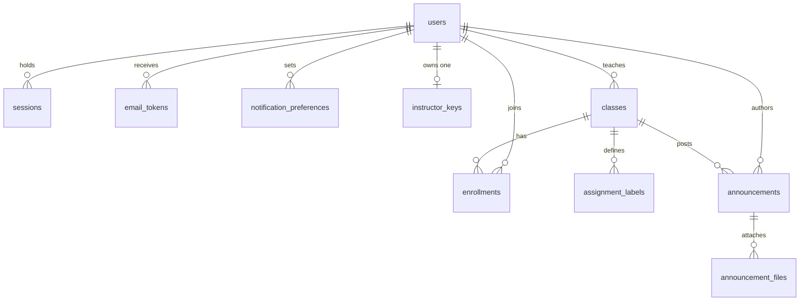
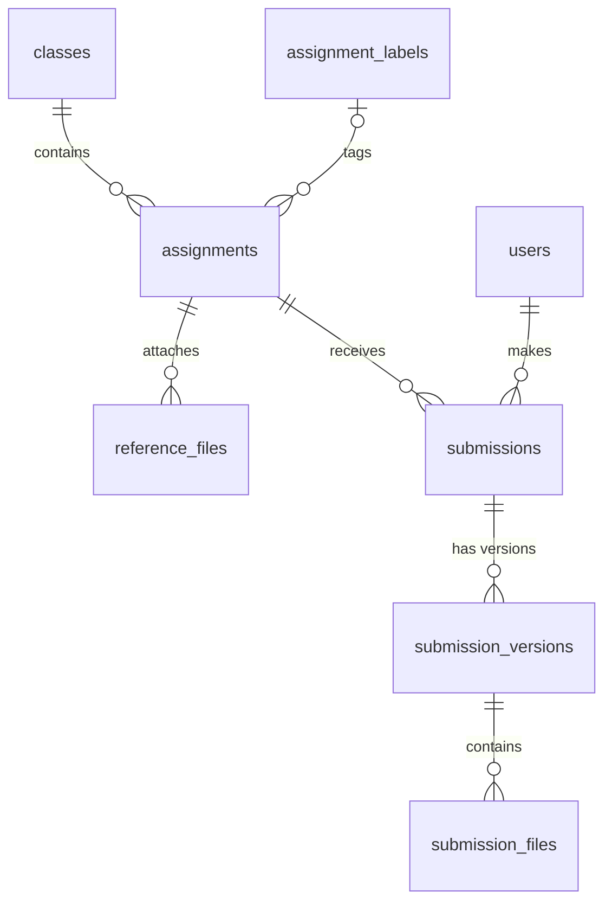
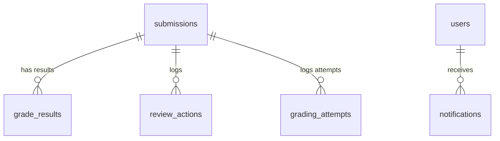

# Backend Schema: EduGemini (v1.0)

| | |
|---|---|
| **Status** | Approved |
| **Owner** | Project owner (sole developer) |
| **Inputs** | [PRD v2.2](prd.md) (requirements), [App Flow v2.2](app-flow.md) (state and system flows), [TRD v1.0](trd.md) (architecture) |
| **Database** | PostgreSQL 15 or later on Supabase (free tier), accessed through Prisma and pg-boss |

> **Single source of truth.** This document holds the Prisma schema (Appendix A) and the raw SQL migration (Appendix B). TRD §5 points here. If the two disagree, this document wins for anything in the database, and the TRD must be updated.

---

## 1. Purpose and scope

**This document owns:** table and column definitions, constraints, indexes, foreign keys and their delete behavior, enums, the state rules the database enforces, derived-value expressions, deletion and retention mechanics, database roles and row-level security, migration workflow, seed data, and sizing.

**This document does not own:** API routes and payloads ([API Spec](api-spec.md)), file-pipeline steps (TRD §9), grading logic (TRD §10), or the UI (UX Brief).

**Rule for changes.** Any schema change follows the migration rules in Section 13. A change that alters a PRD requirement needs the PRD updated first.

---

## 2. Conventions

| Topic | Rule |
|---|---|
| Table names | `snake_case`, plural (`submission_versions`). Set with `@@map` in Prisma |
| Column names | `snake_case`. Set with `@map`. Prisma code uses `camelCase` |
| Primary keys | `uuid`, generated by the application (Prisma `uuid()`). Shown as `Uuid` in tables |
| Timestamps | `timestamptz(3)`, always UTC. Stored as `DateTime @db.Timestamptz(3)` |
| Money-like numbers | Scores are `numeric(6,2)`. Never floats |
| Enums | Postgres enum types, named after the Prisma enum in `snake_case` |
| Text | `text` by default; `varchar(n)` where a length limit applies (set with `@db.VarChar` in Appendix A). Section 4 shows these as `text` with the limit in the Purpose column |
| Nullability | Columns are `NOT NULL` unless marked with `?` in the tables below |
| Soft delete | Not used, except the user **tombstone** (Section 10). Everything else is hard-deleted |
| Foreign keys | Every foreign-key column has an index that leads with that column (Section 9.2 audits this) |
| Actor fields | Columns that record who acted (`approved_by_id`, `decided_by_id`, `actor_id`) are plain `uuid` columns without a foreign key. They must survive account tombstoning |

---

## 3. Entity relationship diagrams

Three diagrams, one per area, so each stays readable. Column detail is in Section 4.

### 3.1 Identity and classes



### 3.2 Assignments and submissions



### 3.3 Grading, review, and operations



Two tables have **no foreign key** and sit outside the diagrams on purpose:
- `audit_logs`: records admin actions by actor and target, and must outlive the rows it describes.
- `storage_deletions`: an outbox of object paths to delete.

Three pointer columns (`grade_results.version_id`, `submissions.current_version_id`, `submissions.active_grade_id`) are also not drawn as ordinary foreign keys. They use deferrable composite foreign keys (Section 7.3).

---

## 4. Table specifications

Notation: `?` after a type means nullable. `FK` lists the referenced table and the delete rule. `UQ` is a unique constraint. `IX` is an index. `CK` is a CHECK constraint (SQL, Appendix B). Each table lists the PRD requirements it serves.

### 4.1 `users`

Accounts for students, instructors, and Super Admins. Accounts are never hard-deleted; deletion makes a tombstone row (Section 10).

| Column | Type | Purpose |
|---|---|---|
| id | Uuid | Primary key |
| email | text | Login email, stored lowercase |
| password_hash | text? | argon2id hash; null for tombstones |
| first_name | text | Display name part (rosters, gradebooks) |
| last_name | text | Display name part |
| role | role | `STUDENT`, `INSTRUCTOR`, or `SUPER_ADMIN` (A6: one role per account) |
| email_verified_at | timestamptz? | Null until verified |
| terms_accepted_at | timestamptz? | Required for non-tombstone accounts (CK) |
| terms_version | text? | Version of the Terms accepted |
| suspended_at | timestamptz? | Set while suspended |
| suspend_reason | text? | Optional reason shown to the user (A16) |
| tombstone | boolean | True after account deletion |
| created_at, updated_at | timestamptz | |

- **UQ:** `email`.
- **CK:** `email = lower(email)`; `position('@' in email) > 1`; tombstone consistency (Appendix B).
- **FK in:** none.
- **Serves:** FR-AUTH-01, 03, 07, 09, 10; FR-ADM-01; A1, A6, A14, A16.

### 4.3 `sessions`

Database-backed sessions. Only the token hash is stored.

| Column | Type | Purpose |
|---|---|---|
| id | Uuid | |
| user_id | Uuid | FK `users` ON DELETE CASCADE |
| token_hash | text | SHA-256 of the session token; UQ |
| created_at | timestamptz | |
| last_seen_at | timestamptz | Updated at most once per 5 minutes to limit writes |
| expires_at | timestamptz | Absolute expiry (30 days, TQ2) |

- **UQ:** `token_hash`. **IX:** `user_id`, `expires_at` (cleanup).
- **CK:** `expires_at > created_at`.
- **Serves:** FR-AUTH-06; app-flow Section 1 step 4.

### 4.4 `email_tokens`

Verification and password-reset tokens. Single use.

| Column | Type | Purpose |
|---|---|---|
| id | Uuid | |
| user_id | Uuid | FK `users` ON DELETE CASCADE |
| purpose | token_purpose | `VERIFY_EMAIL` or `RESET_PASSWORD` |
| token_hash | text | SHA-256 of the token; UQ |
| expires_at | timestamptz | 60 minutes for reset, 24 hours for verification (TQ1) |
| used_at | timestamptz? | Set on use; a used token is rejected |
| created_at | timestamptz | |

- **UQ:** `token_hash`. **IX:** `user_id`, `expires_at`.
- **CK:** `expires_at > created_at`.
- **Serves:** FR-AUTH-04, FR-AUTH-05.

### 4.5 `notification_preferences`

Per-user email switches by category (FR-NTF-04).

| Column | Type | Purpose |
|---|---|---|
| user_id | Uuid | FK `users` ON DELETE CASCADE |
| category | text | Category name (for example `grading`, `joins`, `announcements`) |
| email_on | boolean | Default true |

- **PK:** `(user_id, category)`.
- **Serves:** FR-NTF-04.

### 4.6 `instructor_keys`

An instructor's Gemini API key, encrypted. One active key per instructor (FR-KEY-01).

| Column | Type | Purpose |
|---|---|---|
| id | Uuid | |
| instructor_id | Uuid | FK `users` ON DELETE CASCADE; UQ (one key per instructor) |
| ciphertext | bytea | AES-256-GCM ciphertext of the key |
| iv | bytea | 12-byte random IV, unique per encryption |
| auth_tag | bytea | 16-byte GCM tag |
| key_version | integer | Which `ENCRYPTION_KEY_VERSION` encrypted this row |
| last4 | char(4) | Last four characters of the key, the only part ever shown |
| status | key_status | `CONNECTED`, `NEEDS_ATTENTION`, or `QUOTA_REACHED` |
| last_success_at | timestamptz? | Time of the last successful grading call |
| disclosure_ack_at | timestamptz | When the instructor ticked "I understand" (FR-KEY-04) |
| updated_at | timestamptz | |

- **CK:** `octet_length(iv) = 12`; `octet_length(auth_tag) = 16`; `key_version >= 1`.
- **Save:** a save replaces the row's key (new IV, new `last4`, `key_version` of the running `ENCRYPTION_KEY_VERSION`) and keeps the first `disclosure_ack_at`. Reading it back gives `last4`, `last_success_at` and `disclosure_ack_at`, never the ciphertext.
- **`status`:** storing a key does not set `status` or `last_success_at`. The default `CONNECTED` means nothing until the key is checked with Gemini (EG-KEY-03), and a replace leaves the old values.
- **Serves:** FR-KEY-01 to 06; FR-KEY-03 (never plaintext, never logged).

### 4.7 `classes`

| Column | Type | Purpose |
|---|---|---|
| id | Uuid | |
| instructor_id | Uuid | FK `users` ON DELETE RESTRICT (tombstones keep the row) |
| name | text | 1 to 120 characters (CK) |
| description | text? | |
| section, subject, room | text? | Optional metadata (FR-CLS-01) |
| join_code | text | 8 characters from the 32-character alphabet (CK); UQ |
| join_code_active | boolean | False when disabled (FR-CLS-04) |
| require_approval | boolean | Join approval toggle, default false (FR-CLS-07) |
| attested_at | timestamptz | Instructor attestation time (FR-CLS-09); required |
| archived_at | timestamptz? | Set when archived or when the instructor's account is deleted |
| retention_notice_at | timestamptz? | Set when the 30-day notice is sent (A15) |
| created_at, updated_at | timestamptz | |

- **UQ:** `join_code`.
- **CK:** `join_code ~ '^[A-HJ-NP-Z2-9]{8}$'` (32 characters: letters A to Z without I and O, digits 2 to 9); name length; `retention_notice_at >= archived_at`.
- **IX:** `instructor_id`; partial `archived_at` for the retention sweep (Section 9.3).
- **Serves:** FR-CLS-01, 02, 04, 06, 07, 09, 10, 11; A15.

### 4.8 `enrollments`

| Column | Type | Purpose |
|---|---|---|
| id | Uuid | |
| class_id | Uuid | FK `classes` ON DELETE CASCADE |
| student_id | Uuid | FK `users` ON DELETE RESTRICT |
| status | enrollment_status | `PENDING`, `ACTIVE` (shown as Approved), `DECLINED`, `REMOVED` |
| joined_at | timestamptz | |
| decided_at | timestamptz? | Approve, decline, or remove time |
| decided_by_id | Uuid? | Instructor who decided; no FK (actor field) |

- **UQ:** `(class_id, student_id)` (also the leading index for `class_id`).
- **IX:** `student_id`; `(class_id, status)` for roster counts.
- **Serves:** FR-CLS-03, 05, 07, 08; PRD Section 8.3.

### 4.9 `assignment_labels`

| Column | Type | Purpose |
|---|---|---|
| id | Uuid | |
| class_id | Uuid | FK `classes` ON DELETE CASCADE |
| name | text | Label text (for example `Quiz`) |

- **UQ:** `(class_id, name)`. Labels are per class (TQ7, proposed).
- **Serves:** FR-ASG-08, FR-GB-06.

### 4.10 `assignments`

| Column | Type | Purpose |
|---|---|---|
| id | Uuid | |
| class_id | Uuid | FK `classes` ON DELETE CASCADE |
| label_id | Uuid? | FK `assignment_labels` ON DELETE SET NULL (FR-ASG-08) |
| title | text | |
| instructions | text? | |
| criteria_text | text | Free-text grading criteria; required to publish, may be empty on a draft (FR-ASG-01) |
| criteria_version | integer | Starts at 1; increments on criteria or reference-file change (FR-ASG-04) |
| due_at | timestamptz | Due date and time, UTC (a draft holds a placeholder until it is set) |
| timezone | text | IANA zone for display |
| scoring_format | scoring_format | `POINTS`, `PERCENTAGE`, `LETTER_NUMERIC` |
| max_score | numeric(6,2) | 0 < max ≤ 1000 (CK); 100 for percentage and letter formats |
| letter_scale | jsonb? | Per-assignment letter ranges (FR-ASG-06); null uses the default scale |
| max_resubmissions | integer? | 0 to 10, or null for Unlimited (FR-ASG-10, CK) |
| accept_late | boolean | Default true (FR-ASG-11) |
| status | assignment_status | `DRAFT`, `PUBLISHED`, `ARCHIVED` |
| regrade_not_before | timestamptz? | Debounce target for criteria edits (Section 10.5 of the TRD) |
| published_at | timestamptz? | Set on publish |
| created_at, updated_at | timestamptz | |

- **CK:** resubmission range; `max_score` range; `timezone` non-empty; `status = 'DRAFT' OR published_at IS NOT NULL`.
- **IX:** `(class_id, status, due_at)` (also covers the FK on `class_id`); `label_id`.
- **Serves:** FR-ASG-01 to 11; FR-SUB-04.

### 4.11 `reference_files`

Up to three files per assignment, visible to students only when marked (FR-ASG-07, D4).

| Column | Type | Purpose |
|---|---|---|
| id | Uuid | |
| assignment_id | Uuid | FK `assignments` ON DELETE CASCADE |
| ordinal | integer | 1 to 3 (CK) |
| storage_path | text | Server-generated path; UQ |
| mime_type | text | PDF, JPEG, or PNG (CK) |
| size_bytes | bigint | ≤ 10 MiB (CK) |
| sha256 | text | Integrity and de-duplication check |
| visible_to_students | boolean | Default false |
| created_at | timestamptz | |

- **UQ:** `(assignment_id, ordinal)`; `storage_path`.
- **Serves:** FR-ASG-07; PRD Section 11.

### 4.12 `submissions`

One row per student per assignment (FR-SUB-07). Created when the first version is created, so `state` is null until a version is stored.

| Column | Type | Purpose |
|---|---|---|
| id | Uuid | |
| assignment_id | Uuid | FK `assignments` ON DELETE CASCADE |
| student_id | Uuid | FK `users` ON DELETE RESTRICT |
| state | submission_state? | Null until the first version is stored (Section 6.1) |
| manual_review_cause | manual_review_cause? | Set only when `state = NEEDS_MANUAL_REVIEW` |
| current_version_id | Uuid? | Latest stored version; composite FK (Section 7.3) |
| active_grade_id | Uuid? | The grade students see; composite FK (Section 7.3) |
| resubmissions_used | integer | Attempts consumed (FR-SUB-05); never negative (CK) |
| extra_attempts | integer | Granted or given-back attempts (FR-SUB-10); never negative (CK) |
| late_allowed | boolean | Instructor allowed a late upload when late is closed (FR-SUB-10, A11) |
| first_submitted_at | timestamptz? | |
| latest_submitted_at | timestamptz? | Late is computed from this (A4) |
| approved_at | timestamptz? | Set on approval; cleared on reopen |
| approved_by_id | Uuid? | Instructor who approved; no FK (actor field) |
| instructor_comment | text? | Separate from AI feedback; max 2000 characters (FR-REV-09). Cleared on student deletion |
| created_at, updated_at | timestamptz | |

- **UQ:** `(assignment_id, student_id)`.
- **IX:** `student_id`; `(assignment_id, state)`; partial review-queue index (Section 9.3).
- **CK:** state and current version are both null or both set; state and cause match; state and approval time match; approved submissions have an active grade; time order; attempts (Appendix B). Comment length is enforced by the column type.
- **Serves:** FR-SUB-04 to 07, 09, 10; FR-REV-03 to 05, 09; FR-AI-06; FR-ASG-04.

### 4.13 `submission_versions`

Each upload attempt is a version. Versions are never edited after they are stored.

| Column | Type | Purpose |
|---|---|---|
| id | Uuid | |
| submission_id | Uuid | FK `submissions` ON DELETE CASCADE |
| version_no | integer | 1, 2, 3 …; unique per submission |
| status | version_status | `UPLOADING`, `STORED`, `REPLACED` |
| created_at | timestamptz | |
| stored_at | timestamptz? | Set when finalized |

- **UQ:** `(submission_id, version_no)`; `(id, submission_id)` (target of the composite FK).
- **Partial UQ:** at most one `UPLOADING` version per submission (Section 7.2).
- **CK:** `status = 'UPLOADING'` exactly when `stored_at` is null.
- **Serves:** FR-SUB-03, FR-SUB-05; TRD §9.1.

### 4.14 `submission_files`

| Column | Type | Purpose |
|---|---|---|
| id | Uuid | |
| version_id | Uuid | FK `submission_versions` ON DELETE CASCADE |
| client_file_id | text | Browser-generated idempotency key |
| ordinal | integer | Order as uploaded; 1 to 10 (CK) |
| status | file_status | `STORED` or `FAILED` |
| storage_path | text? | Server-generated; UQ; null when failed |
| display_name | text? | Shown to users only; never used in paths |
| mime_type | text? | PDF, JPEG, or PNG after conversion (CK) |
| size_bytes | bigint? | ≤ 10 MiB (CK) |
| page_count | integer? | 1 to 20 (CK) |
| sha256 | text? | |
| failure_code | text? | `TYPE`, `SIZE`, `PAGES`, `PASSWORD`, or `CORRUPT` (CK) |
| created_at | timestamptz | |

- **UQ:** `(version_id, client_file_id)` (idempotent retries); `storage_path`.
- **CK:** a stored file has path, size, hash, and type; a failed file has a failure code.
- **Serves:** FR-SUB-01, 02, 03; FR-AI-05; A12.

### 4.15 `grade_results`

Every AI or instructor result. The student sees only the result pointed to by `submissions.active_grade_id`.

| Column | Type | Purpose |
|---|---|---|
| id | Uuid | |
| submission_id | Uuid | FK `submissions` ON DELETE CASCADE; `(id, submission_id)` unique |
| version_id | Uuid | Version graded; composite FK with `submission_id` (Section 7.3) |
| source | grade_source | `AI` or `INSTRUCTOR` |
| status | grade_status | `ACTIVE`, `PENDING_REVIEW`, `SUPERSEDED`, `DISCARDED` |
| score | numeric(6,2)? | ≥ 0 and ≤ the assignment's max (trigger, Section 7.4) |
| letter | text? | Derived by the system; A to F with +/- (CK) |
| feedback | text? | AI or instructor feedback; cleared on student deletion |
| criteria_version | integer | Assignment criteria version graded against |
| model | text? | Required when `source = AI` (CK) |
| prompt_version | text? | Required when `source = AI` (CK) |
| confidence | text? | `high`, `medium`, `low` (CK) |
| readability_issue | boolean | Default false |
| created_by_id | Uuid? | Instructor for manual grades; no FK |
| created_at | timestamptz | |

- **UQ:** `(id, submission_id)`.
- **Partial UQ:** one `ACTIVE` and one `PENDING_REVIEW` per submission (Section 7.2).
- **IX:** `(submission_id, status)`.
- **CK:** score ≥ 0; AI provenance; active or pending results have a score; letter and confidence formats.
- **Serves:** FR-AI-01, 03; FR-REV-03, 06, 10; FR-ASG-06; PRD Section 9.2 and 9.6.

### 4.16 `review_actions`

Instructor actions, written for audit and for the edit-tracking metrics (FR-REV-08).

| Column | Type | Purpose |
|---|---|---|
| id | Uuid | |
| submission_id | Uuid | FK `submissions` ON DELETE CASCADE |
| actor_id | Uuid | Who acted; no FK (actor field) |
| action | review_action_type | See Section 5 |
| ai_score | numeric(6,2)? | Score before the instructor's change |
| final_score | numeric(6,2)? | Score after; required for `APPROVE` (CK) |
| edit_class | text? | `edit_free`, `score_only`, `feedback_only`, or `both` (CK) |
| attempts_granted | integer? | Required and positive for `GRANT_ATTEMPTS` (CK) |
| late_allowed | boolean? | Set for `ALLOW_LATE` (CK) |
| created_at | timestamptz | |

- **IX:** `(submission_id, created_at)`.
- **Serves:** FR-REV-03, 05, 06, 08; FR-SUB-10 (logged); PRD Section 14 instrumentation.

### 4.17 `grading_attempts`

One row per Gemini call. Source of the platform health metrics. Contains no content.

| Column | Type | Purpose |
|---|---|---|
| id | Uuid | |
| submission_id | Uuid | FK `submissions` ON DELETE CASCADE |
| version_id | Uuid | Version attempted |
| attempt_no | integer | ≥ 1 (CK) |
| outcome | attempt_outcome | See Section 5 |
| error_class | text? | Retry class from TRD §10.7 |
| latency_ms | integer? | |
| model | text? | Model used |
| created_at | timestamptz | |

- **IX:** `submission_id`; `created_at` (metrics windows).
- **Serves:** FR-AI-04; FR-ADM-03; PRD Section 14 instrumentation.

### 4.18 `announcements`

| Column | Type | Purpose |
|---|---|---|
| id | Uuid | |
| class_id | Uuid | FK `classes` ON DELETE CASCADE |
| author_id | Uuid | FK `users` ON DELETE RESTRICT |
| title | text | 1 to 200 characters (CK) |
| body | text | |
| created_at | timestamptz | |

- **IX:** `author_id`; `(class_id, created_at DESC)` for the stream.
- **Serves:** FR-ANN-01 to 05 (Could).

### 4.19 `announcement_files`

| Column | Type | Purpose |
|---|---|---|
| id | Uuid | |
| announcement_id | Uuid | FK `announcements` ON DELETE CASCADE |
| storage_path | text | UQ |
| mime_type | text | PDF, JPEG, or PNG |
| size_bytes | bigint | ≤ 10 MiB |
| sha256 | text | |
| created_at | timestamptz | |

- **IX:** `announcement_id`.
- **Serves:** FR-ANN-01, 02.

### 4.20 `notifications`

In-app notifications are the source of truth. Email state lives on the same row so digests and retries are queryable.

| Column | Type | Purpose |
|---|---|---|
| id | Uuid | |
| user_id | Uuid | FK `users` ON DELETE CASCADE |
| type | notification_type | One of the 19 events in PRD Section 10 |
| payload | jsonb | Identifiers and short labels only; never grades, feedback, or file names |
| link | text | Relative in-app path (CK: starts with `/`, not `//`) |
| read_at | timestamptz? | |
| email_status | email_status | `PENDING`, `SENT`, `FAILED`, `SKIPPED`; default `SKIPPED` |
| email_after | timestamptz? | Earliest send time; digests set this to the next batch window |
| emailed_at | timestamptz? | |
| created_at | timestamptz | |

- **IX:** `(user_id, read_at, created_at)`; partial unread index (Section 9.3); partial due-email index (Section 9.3).
- **CK:** link format; a pending email has an `email_after` time.
- **Serves:** FR-NTF-01 to 04; PRD Section 10.

### 4.21 `audit_logs`

Admin actions. Append-only (trigger, Section 7.4). Holds metadata only.

| Column | Type | Purpose |
|---|---|---|
| id | Uuid | |
| actor_id | Uuid? | Admin who acted; no FK |
| actor_role | role? | |
| action | text | For example `ACCOUNT_SUSPENDED`, `CLASS_DELETED` |
| target_type | text | Table or concept name |
| target_id | Uuid? | |
| reason | text? | Optional reason (A16) |
| metadata | jsonb? | Counts and flags only; the application never writes content here |
| created_at | timestamptz | |

- **IX:** `created_at`; `(target_type, target_id)`.
- **Serves:** FR-ADM-04; FR-SUB-10 (overrides are also in `review_actions`); PRD Section 11.

### 4.22 `storage_deletions`

Outbox for object-storage deletes. Written in the same transaction as any row delete that leaves files behind, so a crash after commit can be retried (Section 10).

| Column | Type | Purpose |
|---|---|---|
| id | Uuid | |
| bucket | text | Bucket name |
| object_path | text | Full object path; UQ with bucket |
| requested_at | timestamptz | |
| completed_at | timestamptz? | Set when the object is gone (or was already missing) |
| attempts | integer | ≥ 0 (CK) |
| last_error | text? | Last failure message, no secrets |

- **UQ:** `(bucket, object_path)`.
- **Partial IX:** pending rows `(requested_at) WHERE completed_at IS NULL`.
- **Serves:** FR-AUTH-10; FR-CLS-11; FR-ASG-09; FR-ANN-03; A14; A10.

---

## 5. Enums

Each Prisma enum maps to a Postgres enum type of the same meaning.

### 5.1 Role (`role`)
| Value | Meaning |
|---|---|
| `STUDENT` | Student account |
| `INSTRUCTOR` | Instructor account |
| `SUPER_ADMIN` | Platform operator; created by script only (Section 14) |

### 5.2 Enrollment status (`enrollment_status`)
| Value | PRD state | Student access |
|---|---|---|
| `PENDING` | Pending (8.3) | "Pending approval" only |
| `ACTIVE` | Active, shown as "Approved" | Full class access |
| `DECLINED` | Declined | "Declined"; no class access |
| `REMOVED` | Removed | No class access; history kept |

### 5.3 Assignment status (`assignment_status`)
| Value | Meaning |
|---|---|
| `DRAFT` | Saved, invisible to students (FR-ASG-03) |
| `PUBLISHED` | Visible to approved students |
| `ARCHIVED` | Hidden from students; restorable (FR-ASG-09) |

### 5.4 Scoring format (`scoring_format`)
| Value | Meaning |
|---|---|
| `POINTS` | Points out of a maximum (for example 42/50) |
| `PERCENTAGE` | Percentage, max 100 |
| `LETTER_NUMERIC` | Letter derived from a 0 to 100 score |

### 5.5 Submission state (`submission_state`)
| Value | PRD state (8.1) | Notes |
|---|---|---|
| `QUEUED` | Queued | Stored, waiting for grading |
| `GRADING` | Grading | Gemini call running, including silent retries |
| `AI_GENERATED` | AI-generated | Result exists; not approved |
| `NEEDS_MANUAL_REVIEW` | Needs manual review | Cause in `manual_review_cause` |
| `INSTRUCTOR_APPROVED` | Instructor-approved | Locked until reopen |

File error (PRD 8.1) has no value here: a failed upload never creates a valid submission state. It is recorded on `submission_files` (`status = FAILED`).

### 5.6 Manual review cause (`manual_review_cause`)
| Value | Meaning |
|---|---|
| `AI_FAILED` | Retries exhausted (transient errors) |
| `KEY_MISSING` | No key connected |
| `KEY_INVALID` | Key rejected |
| `KEY_QUOTA` | Daily quota reached |
| `FILE_QUALITY` | Unreadable file reached grading (rare; normally caught at upload) |

### 5.7 Version status (`version_status`)
| Value | Meaning |
|---|---|
| `UPLOADING` | Files still arriving; not graded; cleaned up after 24 hours if abandoned |
| `STORED` | Finalized and graded |
| `REPLACED` | Superseded by a newer stored version. Its files and `submission_files` rows are deleted at the same time (Section 10.3a); the version record stays |

### 5.8 File status (`file_status`)
| Value | Meaning |
|---|---|
| `STORED` | Validated and stored |
| `FAILED` | Rejected; `failure_code` says why; never consumes an attempt |

### 5.9 Grade source and status (`grade_source`, `grade_status`)
| Enum | Value | Meaning |
|---|---|---|
| grade_source | `AI` | Produced by Gemini |
| grade_source | `INSTRUCTOR` | Entered or edited by the instructor |
| grade_status | `ACTIVE` | The result students see (at most one per submission) |
| grade_status | `PENDING_REVIEW` | A re-grade of an approved submission awaiting the instructor (FR-REV-10; at most one) |
| grade_status | `SUPERSEDED` | Replaced by a newer active result |
| grade_status | `DISCARDED` | Rejected by "Keep previous grade" or by a stale result |

### 5.10 Key status (`key_status`)
| Value | Meaning |
|---|---|
| `CONNECTED` | Last check or grading call succeeded |
| `NEEDS_ATTENTION` | Invalid or revoked key, or API not enabled |
| `QUOTA_REACHED` | Daily limit reached |

### 5.11 Review action (`review_action_type`)
| Value | Written when |
|---|---|
| `APPROVE` | Instructor approves (with `final_score`) |
| `REOPEN` | Instructor reopens an approved submission |
| `MANUAL_GRADE` | Instructor enters a score and feedback from scratch |
| `GRANT_ATTEMPTS` | Instructor grants attempts, including "Give attempt back" (FR-SUB-10) |
| `ALLOW_LATE` | Instructor allows a late upload |
| `REGRADE_REQUEST` | Instructor starts a re-grade of an approved submission |
| `REGRADE_APPROVE` | Instructor approves the pending re-grade result |
| `REGRADE_KEEP_PREVIOUS` | Instructor discards the pending result |

### 5.12 Attempt outcome (`attempt_outcome`)
| Value | Meaning |
|---|---|
| `SUCCESS` | Valid result |
| `TRANSIENT_ERROR` | Timeout, 5xx, per-minute rate limit, or invalid output |
| `KEY_ERROR` | Key invalid or API not enabled |
| `QUOTA_ERROR` | Daily quota reached |
| `FILE_ERROR` | Unreadable file reached grading |
| `STALE_DISCARDED` | Version changed during the call; result dropped (FR-AI-06) |

### 5.13 Token purpose (`token_purpose`)
`VERIFY_EMAIL`, `RESET_PASSWORD`.

### 5.14 Notification type (`notification_type`)
The 19 notifiable events in PRD Section 10: `SUBMISSION_GRADED`, `GRADE_APPROVED`, `SUBMISSION_AWAITING_REVIEW`, `NEEDS_MANUAL_REVIEW_INSTRUCTOR`, `NEEDS_MANUAL_REVIEW_STUDENT`, `KEY_NEEDS_ATTENTION`, `REGRADE_COMPLETE`, `SUBMISSION_REOPENED`, `JOIN_REQUEST_RECEIVED`, `JOIN_DECIDED`, `ATTEMPTS_GRANTED`, `LATE_ALLOWED`, `ASSIGNMENT_PUBLISHED`, `DUE_DATE_CHANGED`, `CLASS_DELETED`, `INSTRUCTOR_ACCOUNT_DELETED`, `ACCOUNT_STATUS_CHANGED`, `RETENTION_NOTICE`, `ANNOUNCEMENT_POSTED`. File errors are shown on screen and are not notifications.

### 5.15 Email status (`email_status`)
| Value | Meaning |
|---|---|
| `PENDING` | Waiting to be sent after `email_after` |
| `SENT` | Sent |
| `FAILED` | Failed after retries (the in-app notification still exists) |
| `SKIPPED` | Not an email event, unverified recipient, or opted out |

---

## 6. State rules in the database

### 6.1 Submission

| From | To | Trigger | Columns that change | What enforces it |
|---|---|---|---|---|
| (none) | (version UPLOADING) | Student starts an upload | `submissions` row created with `state` null; a version with `status = UPLOADING` | Partial UQ (one UPLOADING per submission); service checks attempts and due rules first |
| null | `QUEUED` | Finalize | `state`, `current_version_id`, `latest_submitted_at`, `first_submitted_at` (first version only), `resubmissions_used` (second and later versions) | CK state/current version; service increments attempts in the same transaction, locked row |
| `QUEUED` | `GRADING` | Worker starts a call | `state` | Service; singleton job per submission |
| `GRADING` | `AI_GENERATED` | Valid result | `state`; new `grade_results` ACTIVE; `active_grade_id` | Partial UQ (one ACTIVE); composite FK on `active_grade_id` |
| `GRADING` | `NEEDS_MANUAL_REVIEW` | Retries exhausted or key problem | `state`, `manual_review_cause` | CK cause matches state |
| `AI_GENERATED` / `NEEDS_MANUAL_REVIEW` | `INSTRUCTOR_APPROVED` | Approve | `state`, `approved_at`, `approved_by_id`; grade `INSTRUCTOR` ACTIVE | CK approval time matches state; CK approved has grade |
| `INSTRUCTOR_APPROVED` | `AI_GENERATED` | Reopen | `state`, `approved_at` cleared | CK approval time matches state |
| `AI_GENERATED` / `NEEDS_MANUAL_REVIEW` | `QUEUED` | Criteria changed, or student resubmits | `state`, `active_grade_id` nulled for unapproved criteria re-grades | Service; the old grade is marked `SUPERSEDED` in the same transaction |
| `INSTRUCTOR_APPROVED` (grade pending) | `INSTRUCTOR_APPROVED` | Re-grade of approved | `grade_results` PENDING_REVIEW added; `state` unchanged | Partial UQ (one PENDING_REVIEW) |

The student sees the approved grade the whole time a re-grade is pending, because `active_grade_id` does not move until the instructor approves (FR-REV-10).

### 6.2 Enrollment

| From | To | Trigger |
|---|---|---|
| (none) | `PENDING` | Join with approval on |
| (none) | `ACTIVE` | Join with approval off |
| `PENDING` | `ACTIVE` / `DECLINED` | Instructor decision |
| `DECLINED` | `ACTIVE` | Instructor reverses |
| `ACTIVE` | `REMOVED` | Instructor removes |
| `REMOVED` | `ACTIVE` | Instructor reinstates |

The database does not restrict these transitions beyond the enum. The service enforces them in one place, and a test checks the table above (TRD §7.2).

### 6.3 Assignment

`DRAFT` → `PUBLISHED` (sets `published_at`) → `ARCHIVED` → `PUBLISHED`. Delete is allowed from any state and cascades (Section 10). CK: a non-draft has `published_at`.

### 6.4 Key, grade, and version states

Key status (Section 5.10) changes on a grading call or a manual "Test connection", never on a timer (TRD §11.5). Grade status follows Section 6.1. A version moves from `UPLOADING` to `STORED` once, at finalize, and `STORED` to `REPLACED` when a newer version is finalized. At that moment the previous version's files are deleted (Section 10.3a).

---

## 7. Integrity rules beyond Prisma

Prisma cannot express CHECK constraints, partial unique indexes, deferrable composite foreign keys, triggers, or row-level security. These live in the raw SQL migration (Appendix B). Each rule below names the requirement it protects.

### 7.1 CHECK constraints

| Table | Rule | Protects |
|---|---|---|
| `users` | Email lowercase; tombstones have no password and a `deleted-…@tombstone.invalid` address | FR-AUTH-01, FR-AUTH-10 |
| `users` | Non-tombstone accounts have `terms_accepted_at` | FR-AUTH-09 |
| `classes` | Join code format (32-character alphabet) | FR-CLS-02 |
| `classes` | Name 1 to 120 characters; retention notice after archive | FR-CLS-01, A15 |
| `assignments` | Resubmission limit 0 to 10 or null | FR-ASG-10 |
| `assignments` | `max_score` 0 to 1000 | FR-ASG-01 |
| `assignments` | Published (non-draft) has `published_at` | FR-ASG-03 |
| `reference_files` | Ordinal 1 to 3; ≤ 10 MiB; allowed types | FR-ASG-07, FR-SUB-02 |
| `submissions` | Attempt counters never negative | FR-SUB-05, FR-SUB-10 |
| `submissions` | Current version set exactly when state is set | Section 6.1 |
| `submissions` | `NEEDS_MANUAL_REVIEW` exactly when a cause is set | FR-KEY-05, FR-AI-04 |
| `submissions` | `INSTRUCTOR_APPROVED` exactly when `approved_at` is set; approved submissions have an active grade | FR-SUB-06, FR-REV-04 |
| `submissions` | First submission time not after the latest (the 2000-character comment limit is the `varchar(2000)` column type) | FR-SUB-04; FR-REV-09 |
| `submission_versions` | `UPLOADING` exactly when not yet stored | FR-SUB-03 |
| `submission_files` | Stored files have path, size, hash, and type; failed files have a code | FR-SUB-01, FR-AI-05 |
| `submission_files` | ≤ 10 MiB; 1 to 20 pages; ordinal 1 to 10; allowed types; allowed failure codes | FR-SUB-02 |
| `grade_results` | Score ≥ 0; AI results record model and prompt version; active and pending results have a score | FR-AI-01, PRD 9.6 |
| `grade_results` | Letter format; confidence values | PRD 9.2, 9.4 |
| `review_actions` | Approvals carry a final score; grants are positive; edit class values | FR-REV-03, FR-REV-08, FR-SUB-10 |
| `grading_attempts` | Attempt number ≥ 1 | FR-AI-04 |
| `notifications` | Link is a relative in-app path; a pending email has a send time | FR-NTF-02 |
| `instructor_keys` | IV is 12 bytes, tag 16 bytes, last four is 4 characters | FR-KEY-03 |
| `sessions`, `email_tokens` | Expiry after creation | FR-AUTH-05, FR-AUTH-06 |
| `announcements` | Title 1 to 200 characters | FR-ANN-01 |
| `storage_deletions` | Attempts never negative | Section 10 |

### 7.2 Partial unique indexes

| Index | Rule | Why it is needed |
|---|---|---|
| `grade_results_one_active` on `(submission_id) WHERE status = 'ACTIVE'` | At most one visible grade per submission | Students must never see two grades (FR-AI-03) |
| `grade_results_one_pending` on `(submission_id) WHERE status = 'PENDING_REVIEW'` | At most one pending re-grade (FR-REV-10) | A second re-grade would make "Keep previous" ambiguous |
| `submission_versions_one_uploading` on `(submission_id) WHERE status = 'UPLOADING'` | At most one open upload per submission | Two open uploads would race at finalize (FR-SUB-07) |

**Order of updates when approving a pending re-grade.** Inside one transaction: (1) set the old ACTIVE grade to `SUPERSEDED`, (2) set the pending grade to `ACTIVE`, (3) point `active_grade_id` at it. Doing these in another order breaks the partial unique index.

### 7.3 Deferrable composite foreign keys

Three pointers must reference rows that belong to the same submission. A plain foreign key cannot check that.

```sql
ALTER TABLE submissions
  ADD CONSTRAINT submissions_current_version_fk
  FOREIGN KEY (current_version_id, id)
  REFERENCES submission_versions (id, submission_id)
  DEFERRABLE INITIALLY DEFERRED;

ALTER TABLE submissions
  ADD CONSTRAINT submissions_active_grade_fk
  FOREIGN KEY (active_grade_id, id)
  REFERENCES grade_results (id, submission_id)
  DEFERRABLE INITIALLY DEFERRED;

ALTER TABLE grade_results
  ADD CONSTRAINT grade_results_version_fk
  FOREIGN KEY (version_id, submission_id)
  REFERENCES submission_versions (id, submission_id)
  DEFERRABLE INITIALLY DEFERRED;
```

- Deferred to commit, so a transaction can insert a version, grade, and submission update in any order.
- A null pointer skips the check (standard MATCH SIMPLE behavior), which is correct: `active_grade_id` and `current_version_id` are null until used.
- These are not declared in `schema.prisma`. Prisma sees them only as database objects (Section 13.3 covers the drift risk).

### 7.4 Triggers

| Trigger | Rule | Protects |
|---|---|---|
| `grade_score_in_range` on `grade_results` (insert, and update of `score`) | The score must not exceed the assignment's `max_score`, found through the submission. Rejects with `check_violation` | FR-AI-01, FR-REV-03: a model output above max is caught even if application code misses it (TRD §10.6) |
| `audit_logs_append_only` on `audit_logs` (update or delete) | Raises an error for every update, and for every delete of a row younger than 12 months. Only the retention sweep deletes, and only rows older than 12 months (Section 10.9) | FR-ADM-04 |

`review_actions` and `grading_attempts` are **not** append-only, because they are deleted by cascade when their submission is deleted. Their integrity comes from the cascade, not from a trigger.

### 7.5 Row-level security

Every application table has RLS enabled with one policy: `app_runtime_all`, which lets the runtime role do anything. No policy exists for `anon` or `authenticated`, so anything reaching the table through Supabase's public API is denied (Section 12.2). Section 12.2 gives the exact statements.

---

## 8. Derived values

Late, Missing, Closed, attempts remaining, and the tracker counts are computed, not stored (TRD §5.2). The expressions below are the single definition. The application and any export must use them, and the tests check them against the PRD cases.

### 8.1 Per-submission flags

```sql
-- Late (PRD FR-SUB-04; A4): latest stored submission is after the due date
(s.latest_submitted_at IS NOT NULL AND s.latest_submitted_at > a.due_at)               AS is_late

-- Attempts remaining (FR-SUB-09). NULL means Unlimited.
CASE WHEN a.max_resubmissions IS NULL THEN NULL
     ELSE GREATEST(0, a.max_resubmissions + s.extra_attempts - s.resubmissions_used)
END                                                                                     AS attempts_left

-- Criteria changed since approval (FR-ASG-04)
(s.state = 'INSTRUCTOR_APPROVED' AND g.criteria_version < a.criteria_version)          AS criteria_changed
-- where g is the grade row s.active_grade_id points to
```

### 8.2 Student-row status

```sql
-- Missing: past due, nothing stored (no submission row, or no current version)
(s.current_version_id IS NULL AND now() > a.due_at)                                     AS is_missing

-- Not yet due: before the due date, nothing stored
(s.current_version_id IS NULL AND now() <= a.due_at)                                    AS is_not_yet_due

-- Closed: past due, late not accepted, and no individual allowance
(now() > a.due_at AND NOT a.accept_late AND NOT COALESCE(s.late_allowed, false))        AS is_closed
```

`is_closed` uses the student's `late_allowed` value. If there is no submission row yet, that value is false. An instructor's "Allow late submission" on a student with no row therefore creates the row with `late_allowed = true` and `state` null (Section 10.4). That row is then Missing, not Closed.

### 8.3 Tracker counts for one assignment

Approved students only. Removed, declined, and pending students are excluded (PRD 7.8, FR-GB-04).

```sql
WITH roster AS (
  SELECT e.student_id
    FROM enrollments e
   WHERE e.class_id = $1
     AND e.status = 'ACTIVE'
), a AS (
  SELECT * FROM assignments WHERE id = $2
)
SELECT
  count(*) FILTER (WHERE s.current_version_id IS NOT NULL)                              AS turned_in,
  count(*) FILTER (WHERE s.current_version_id IS NOT NULL
                     AND s.latest_submitted_at > a.due_at)                              AS late,
  count(*) FILTER (WHERE s.current_version_id IS NULL AND now() > a.due_at)              AS missing,
  count(*) FILTER (WHERE s.current_version_id IS NULL AND now() <= a.due_at)             AS not_yet_due,
  count(*) FILTER (WHERE s.state = 'NEEDS_MANUAL_REVIEW')                                AS needs_review
FROM roster r
CROSS JOIN a
LEFT JOIN submissions s
       ON s.student_id = r.student_id
      AND s.assignment_id = a.id;
```

"Turned in" includes Late and Needs manual review, which are subsets (FR-GB-04, F7). The class average is computed separately, over approved scores only, and shown only when at least five graded submissions exist (A5).

---

## 9. Indexes and query patterns

### 9.1 Query-to-index map

Expected scale: up to 150 students per class, 30 assignments per instructor, around 200 uploads in a burst for one assignment (PRD Sections 4 and 12).

| Query | Frequency | Index that serves it |
|---|---|---|
| Join by code (`WHERE join_code = $1`) | Per join | `classes_join_code_key` (unique) |
| Student dashboard (classes by student) | Per page view | `enrollments_student_id_idx` |
| Instructor class list | Per page view | `classes_instructor_id_idx` |
| Assignment list for a class | Per page view | `assignments_class_id_status_due_at_idx` |
| Student's own submission for an assignment | Per assignment view | `submissions_assignment_id_student_id_key` (unique) |
| Review queue (unapproved or needs review, one instructor) | Per queue view | Partial `submissions_review_queue_idx` (Section 9.3) |
| Tracker counts and rows | Per tracker view | `submissions_assignment_id_state_idx`; roster via `enrollments_class_id_status_idx` |
| Gradebook (students × assignments) | Per gradebook view | `enrollments_class_id_status_idx`; `submissions_assignment_id_student_id_key` |
| Active grade for a submission | Per result view | `grade_results_one_active` (partial unique) |
| Unread notification count | Every 60 seconds per open client | Partial `notifications_unread_idx` |
| Notification list (newest first) | Per notifications view | `notifications_user_id_read_at_created_at_idx` |
| Digest and email send queue | Hourly, and per immediate send | Partial `notifications_email_due_idx` |
| Retention sweep | Daily | Partial `classes_archived_idx` |
| Abandoned uploads | Hourly | Partial `submission_versions_uploading_idx` |
| Pending storage deletes | Each cleanup run | Partial `storage_deletions_pending_idx` |
| Live announcements | Per class view | Partial `announcements_live_idx` |
| Session lookup by token hash | Every authenticated request | `sessions_token_hash_key` (unique) |
| Session and token cleanup | Daily | `sessions_expires_at_idx`, `email_tokens_expires_at_idx` |
| Admin audit view | Occasional | `audit_logs_created_at_idx`; `audit_logs_target_type_target_id_idx` |
| Platform health (grading outcomes) | Admin view | `grading_attempts_created_at_idx` |

### 9.2 Foreign-key index audit

Postgres does not index foreign-key columns automatically, and deleting a parent scans its children. Every foreign key below has an index that leads with its column.

| Foreign key | Leading index |
|---|---|
| `sessions.user_id` | `sessions_user_id_idx` |
| `email_tokens.user_id` | `email_tokens_user_id_idx` |
| `notification_preferences.user_id` | Primary key |
| `instructor_keys.instructor_id` | Unique key |
| `classes.instructor_id` | `classes_instructor_id_idx` |
| `enrollments.class_id` | Unique `(class_id, student_id)` |
| `enrollments.student_id` | `enrollments_student_id_idx` |
| `assignment_labels.class_id` | Unique `(class_id, name)` |
| `assignments.class_id` | `assignments_class_id_status_due_at_idx` |
| `assignments.label_id` | `assignments_label_id_idx` |
| `reference_files.assignment_id` | Unique `(assignment_id, ordinal)` |
| `submissions.assignment_id` | Unique `(assignment_id, student_id)` |
| `submissions.student_id` | `submissions_student_id_idx` |
| `submission_versions.submission_id` | Unique `(submission_id, version_no)` |
| `submission_files.version_id` | Unique `(version_id, client_file_id)` |
| `grade_results.submission_id` | `grade_results_submission_id_status_idx` |
| `review_actions.submission_id` | `review_actions_submission_id_created_at_idx` |
| `grading_attempts.submission_id` | `grading_attempts_submission_id_idx` |
| `announcements.class_id` | Non-partial index `(class_id, created_at)`. The partial live index does not serve foreign-key checks |
| `announcements.author_id` | `announcements_author_id_idx` |
| `announcement_files.announcement_id` | `announcement_files_announcement_id_idx` |
| `notifications.user_id` | `notifications_user_id_read_at_created_at_idx` |

A test queries `pg_constraint` and `pg_index` for any foreign key whose leading column lacks an index, and fails if one is found.

### 9.3 Partial indexes

```sql
CREATE INDEX submissions_review_queue_idx
  ON submissions (assignment_id, latest_submitted_at)
  WHERE state IN ('AI_GENERATED', 'NEEDS_MANUAL_REVIEW');

CREATE INDEX submissions_approved_idx
  ON submissions (assignment_id)
  WHERE state = 'INSTRUCTOR_APPROVED';

CREATE INDEX notifications_unread_idx
  ON notifications (user_id, created_at DESC)
  WHERE read_at IS NULL;

CREATE INDEX notifications_email_due_idx
  ON notifications (email_after)
  WHERE email_status = 'PENDING';

CREATE INDEX classes_archived_idx
  ON classes (archived_at)
  WHERE archived_at IS NOT NULL;

CREATE INDEX submission_versions_uploading_idx
  ON submission_versions (created_at)
  WHERE status = 'UPLOADING';

CREATE INDEX storage_deletions_pending_idx
  ON storage_deletions (requested_at)
  WHERE completed_at IS NULL;

CREATE INDEX announcements_stream_idx
  ON announcements (class_id, created_at DESC);
```

The review queue query also includes submissions that have a pending re-grade (FR-REV-01). Those are found through `grade_results_one_pending`, so the queue query is a union of the two paths. Archived classes are excluded from the queue (open question 3).

### 9.4 Queue ordering

Flagged items first (Needs manual review, Late, or the low-confidence or readability marker), then oldest first (App Flow Section 7, step 2). `a` is the assignment and `g` is the active grade:

```sql
ORDER BY (s.state = 'NEEDS_MANUAL_REVIEW'
          OR s.latest_submitted_at > a.due_at
          OR g.confidence = 'low'
          OR g.readability_issue) DESC,
         s.latest_submitted_at ASC
```

---

## 10. Deletion and retention

### 10.1 General rule: outbox before delete

Any statement that removes a row which points at a stored object follows the same pattern, in one transaction:

1. Insert one `storage_deletions` row per object path being orphaned.
2. Delete or update the rows.
3. Commit.
4. After commit, a `storage.cleanup` job deletes the objects, marks each outbox row complete, and retries failures.

A crash between steps 3 and 4 leaves pending outbox rows, which the job finds on restart. A crash before step 3 rolls the whole thing back. Objects are never deleted before the database commit that removes access to them.

### 10.2 Class deletion (FR-CLS-11)

Triggered by the instructor (with confirmation) or the Super Admin (FR-ADM-02).

1. Count what will be removed, for the confirmation dialog: students, assignments, submissions.
2. In one transaction:
   - Insert `storage_deletions` for every `storage_path` in `submission_files`, `reference_files`, and `announcement_files` under the class.
   - Delete the `classes` row. Cascades remove enrollments, labels, assignments, reference files, submissions, versions, files, grades, review actions, grading attempts, announcements, and announcement files.
   - Insert the `audit_logs` row (Super Admin deletes only).
3. Commit. Approved students get `CLASS_DELETED` notifications. The instructor is notified too when the Super Admin deleted the class.

Notifications that point at the class keep their rows, so their links show "This item is no longer available" (App Flow Section 10).

### 10.2a Replaced versions (FR-SUB-05)

Only the current version keeps files. When a finalize stores version N+1, the same transaction:

1. Inserts `storage_deletions` for every `storage_path` of version N.
2. Deletes version N's `submission_files` rows.
3. Sets version N to `REPLACED`.

The outbox then removes the objects from the bucket (Section 10.1). The version record (number, `created_at`, `stored_at`) stays, because attempt counts and Late timing depend on it. A resubmission that never finalizes leaves version N untouched. Abandoned uploads are cleaned up by Section 10.8.

### 10.3 Student account deletion (FR-AUTH-10, A14)

Triggered by the student in Settings, or by the Super Admin.

In one transaction:

1. Insert `storage_deletions` for every file of every version of the student's submissions.
2. Delete the student's `submission_files` rows (the metadata of the files, not the versions).
3. Clear content from what remains. The score, letter, state, and timestamps stay for the gradebook:

```sql
UPDATE grade_results g
   SET feedback = NULL
  FROM submissions s
 WHERE g.submission_id = s.id
   AND s.student_id = $1;

UPDATE submissions
   SET instructor_comment = NULL
 WHERE student_id = $1;
```

4. Delete the student's sessions, `email_tokens`, `notification_preferences`, and `notifications`.
5. Tombstone the user row (below).

The `submission_versions` rows are kept (number, status, timestamps only). The `submissions.current_version_id` pointer stays valid, so the constraints still hold. `enrollments` rows are kept so the gradebook can show "Deleted student".

```sql
UPDATE users
   SET email          = 'deleted-' || id::text || '@tombstone.invalid',
       password_hash  = NULL,
       first_name     = 'Deleted',
       last_name      = 'student',
       suspended_at   = NULL,
       suspend_reason = NULL,
       tombstone      = true
 WHERE id = $1;
```

The tombstone row keeps its `role` and `terms_*` fields. The `terms_accepted_at` check exempts tombstones (Appendix B).

### 10.4 Instructor account deletion (FR-AUTH-10)

In one transaction:

1. Delete the `instructor_keys` row (the ciphertext goes at once).
2. Set `archived_at = now()` on the instructor's classes that are not already archived. The retention clock starts here (A10).
3. Insert `INSTRUCTOR_ACCOUNT_DELETED` notifications for each approved student of those classes.
4. Delete sessions, tokens, preferences, and notifications for the instructor.
5. Tombstone the user row, as in Section 10.3.

Queued grading jobs for these classes stop on their next run. The worker finds no key and the instructor is a tombstone, so it records `KEY_MISSING` and exits without calling Gemini (TRD §10.3, step 2).

**Allow late submission for a student with no submission row.** Creates a `submissions` row with `state` null, `current_version_id` null, and `late_allowed = true`, in one transaction with the `review_actions` row (`ALLOW_LATE`).

### 10.5 Assignment deletion (FR-ASG-09)

1. Insert `storage_deletions` for the assignment's reference files and submission files.
2. Delete the `assignments` row. Cascades remove its reference files, submissions, versions, files, grades, review actions, and attempts.
3. Commit, then the outbox cleans the objects.

### 10.6 Announcement deletion (FR-ANN-03)

In one transaction, insert `storage_deletions` for each attachment, then delete the `announcements` row (its attachment rows cascade). Commit, then the outbox removes the objects (Section 10.1). Nothing is kept. Notifications that point at the announcement keep their rows, so their links show "This item is no longer available" (App Flow Section 10).

### 10.7 Retention sweep (A10, A15)

Daily job. Each step is idempotent.

| Step | Query condition | Action |
|---|---|---|
| Notice | `archived_at <= now() - interval '335 days' AND retention_notice_at IS NULL` | Send `RETENTION_NOTICE` (with the gradebook CSV link) if the instructor's account still exists; set `retention_notice_at` |
| Purge | `archived_at <= now() - interval '365 days'` | Run the class deletion path (Section 10.2), one class per transaction |

Retention notices for tombstoned instructors are not sent (PRD Section 10). Their classes are still purged at 365 days.

The same job also deletes `audit_logs` rows older than 12 months (Section 10.9).

### 10.8 Upload cleanup

Hourly: versions in `UPLOADING` older than 24 hours are deleted. Their file rows cascade. Their objects are listed in `storage_deletions` first, in the same transaction.

### 10.9 Retention of audit data

`audit_logs` are kept for 12 months. The daily retention sweep runs `DELETE FROM audit_logs WHERE created_at < now() - interval '12 months'`. The `audit_logs_append_only` trigger (Section 7.4) allows exactly this delete and rejects any other. The runtime role already has `DELETE` on every `public` table (Section 12.2), so the trigger is the only guard.

---

## 11. pg-boss

pg-boss runs the grading and background jobs (TRD §10.1). It keeps its own schema and tables.

| Topic | Rule |
|---|---|
| Schema | `pgboss`, created and migrated by pg-boss itself when `db:boss:init` runs |
| Who creates it | The migration owner, in a deploy step (`pnpm db:boss:init`), because creating a schema needs elevated rights. It also applies the grants in Section 11.1. The API starts with `migrate: false`, so it never creates or migrates the schema and refuses to start if it is missing or out of date |
| Runtime connection | The `app_runtime` role over the session pooler (`PGBOSS_URL`, Section 12.3). pg-boss needs session semantics for its advisory locks |
| Prisma | Never touches `pgboss`. Migrations manage only `public` |
| Exposure | `pgboss` is not in Supabase's exposed API schemas (default: `public` only). Do not add it |
| Job retention | Completed jobs are deleted after 7 days (`deleteAfterSeconds`, pg-boss's default). pg-boss 12 has no separate archive step |
| Monitor | Queue sizes and failed-job counts by queue, read by the admin health view (FR-ADM-03) |
| Version | Pinned exactly in `apps/api/package.json` (12.38.2). A pg-boss upgrade follows Section 13 (its own migrations run through `db:boss:init`) |

### 11.1 Grants for pg-boss

```sql
GRANT USAGE ON SCHEMA pgboss TO app_runtime;
GRANT SELECT, INSERT, UPDATE, DELETE ON ALL TABLES IN SCHEMA pgboss TO app_runtime;
GRANT USAGE, SELECT, UPDATE ON ALL SEQUENCES IN SCHEMA pgboss TO app_runtime;
```

`db:boss:init` applies them after it installs or migrates the schema, so running it again after each pg-boss upgrade covers the new tables.

---

## 12. Security at the database

### 12.1 Roles

| Role | Used by | Privileges |
|---|---|---|
| `postgres` (Supabase owner) | Prisma migrations (`DIRECT_URL`), `db:boss:init`, seed scripts | Owns all objects. Bypasses RLS as the table owner |
| `app_runtime` | The API and the worker (`DATABASE_URL`, `PGBOSS_URL`) | CRUD on `public` tables and on `pgboss`. Subject to RLS, with a permissive policy (Section 12.2). Cannot alter schema |
| `anon`, `authenticated` (Supabase) | Supabase's public API, which this app does not use | No privileges on app tables (Section 12.2) |

The Super Admin is an application role, not a database role. Admin actions go through the API and the metadata-only repository (TRD §7.3).

### 12.2 Row-level security

RLS is enabled on every application table. The runtime role gets one permissive policy per table. The public roles get nothing.

```sql
DO $$
DECLARE t text;
BEGIN
  FOREACH t IN ARRAY ARRAY[
    'users','sessions','email_tokens','notification_preferences',
    'instructor_keys','classes','enrollments','assignment_labels','assignments',
    'reference_files','submissions','submission_versions','submission_files',
    'grade_results','review_actions','grading_attempts','announcements',
    'announcement_files','notifications','audit_logs','storage_deletions'
  ] LOOP
    EXECUTE format('ALTER TABLE public.%I ENABLE ROW LEVEL SECURITY', t);
    EXECUTE format(
      'CREATE POLICY app_runtime_all ON public.%I FOR ALL TO app_runtime USING (true) WITH CHECK (true)',
      t);
    EXECUTE format('REVOKE ALL ON public.%I FROM anon, authenticated', t);
  END LOOP;
END $$;
```

Why this shape: the policy lets the API work normally, and denying `anon` and `authenticated` means that even if the public API URL and key were used against a table, nothing would be returned. Authorization stays in the application (TRD §7); RLS is the backstop for the public path only.

### 12.3 Connection strings

| Variable | Role | Pooler | Use |
|---|---|---|---|
| `DATABASE_URL` | `app_runtime` | Transaction pooler (port 6543), `?pgbouncer=true` | Prisma queries |
| `DIRECT_URL` | `postgres` | Session pooler (port 5432) | `prisma migrate deploy`, `db:boss:init` |
| `PGBOSS_URL` | `app_runtime` | Session pooler (port 5432) | pg-boss runtime |

Supabase's pooler expects the username in the form `role.project-ref`. Confirm the exact form in spike S2 (TRD §17.1). Passwords are set outside the migrations, from the environment, never committed:

```sql
-- run once, out of band, with the password from the environment
ALTER ROLE app_runtime WITH LOGIN PASSWORD :'app_runtime_password';
```

### 12.4 Role creation

```sql
DO $$
BEGIN
  IF NOT EXISTS (SELECT 1 FROM pg_roles WHERE rolname = 'app_runtime') THEN
    CREATE ROLE app_runtime NOLOGIN NOINHERIT;
  END IF;
  -- Supabase provides these roles. Plain Postgres (the CI service container) does not, so create them there.
  IF NOT EXISTS (SELECT 1 FROM pg_roles WHERE rolname = 'anon') THEN
    CREATE ROLE anon NOLOGIN NOINHERIT;
  END IF;
  IF NOT EXISTS (SELECT 1 FROM pg_roles WHERE rolname = 'authenticated') THEN
    CREATE ROLE authenticated NOLOGIN NOINHERIT;
  END IF;
END $$;

GRANT USAGE ON SCHEMA public TO app_runtime;
GRANT SELECT, INSERT, UPDATE, DELETE ON ALL TABLES IN SCHEMA public TO app_runtime;
ALTER DEFAULT PRIVILEGES IN SCHEMA public
  GRANT SELECT, INSERT, UPDATE, DELETE ON TABLES TO app_runtime;

REVOKE ALL ON ALL TABLES IN SCHEMA public FROM anon, authenticated;
ALTER DEFAULT PRIVILEGES IN SCHEMA public
  REVOKE ALL ON TABLES FROM anon, authenticated;
```

Whether the project may create roles on the free tier must be confirmed in spike S2. If not, the fallback is to use the `postgres` role for the API with RLS still enabled, and record that as a deviation.

### 12.5 Instructor key encryption

| Item | Rule |
|---|---|
| Algorithm | AES-256-GCM |
| Key | `ENCRYPTION_KEY` (32 bytes), environment only (TRD Appendix A) |
| Per-row values | `ciphertext`, `iv` (12 random bytes, never reused), `auth_tag` (16 bytes) |
| Versioning | `key_version` names the key that encrypted the row. Reading uses the current `ENCRYPTION_KEY` only, so a row from another version cannot be read until rotation is built |
| Rotation | Deploy the new key as version N+1 while keeping version N. A job re-encrypts rows still on N, then N is removed |
| Display | Only `last4` is ever returned by the API |
| Logging | The key is never logged; pino redaction covers `ciphertext`, `key`, and `iv` (TRD §14) |

### 12.6 What is never stored

| Item | Rule |
|---|---|
| Plaintext instructor keys | Never. Only ciphertext and the last four characters |
| Session tokens and email tokens | Never. SHA-256 hashes only |
| Passwords | Never. argon2id hashes only |
| Original file names in storage paths | Never. Paths are built from IDs and an ordinal |
| Student work in logs, metrics, or audit rows | Never. `grading_attempts` and `audit_logs` hold identifiers, counts, and codes |
| Gemini request or response bodies | Never stored. Only the validated result fields are kept (`grade_results`) |
| Student identity sent to Gemini | Never (TRD §10.4); the schema has no field for it to leak through |

---

## 13. Migrations

### 13.1 Workflow

| Step | Command or action | Who |
|---|---|---|
| Change `schema.prisma` | Edit Appendix A's schema in the repository's `schema.prisma` | Developer |
| Create the migration without applying | `prisma migrate dev --create-only --name <short_name>` | Developer, local |
| Add raw SQL | Edit the generated `migration.sql` to add the CHECK, partial index, composite FK, trigger, or RLS statements the change needs | Developer, local |
| Review | Read the generated SQL. Confirm it does not drop any object listed in Section 7 or Appendix B | Developer, reviewer |
| Apply in development | `prisma migrate dev` against the `edugemini` project (TRD §4.1) | Developer, local |
| Apply in production | `prisma migrate deploy` in the Render start command (TRD §4.5) | Automated, on deploy |
| Test database | `prisma migrate reset --force` against the `edugemini-test` project only (the E2E safety guard, TRD §16.2a) | Test runner |

### 13.2 Rules

- **Forward-only.** No down migrations. A bad migration is fixed by a new migration.
- **Expand, then contract.** To rename or remove a column: (1) add the new column and write to both, (2) backfill, (3) switch reads, (4) stop writing the old one, (5) drop it in a later migration. Each step deploys separately.
- **Constraints are added in two steps for large tables.** Add `NOT VALID`, then `VALIDATE CONSTRAINT`, so the table is not locked for the whole check. For the free-tier data sizes in Section 15 this is precautionary.
- **Indexes on existing tables** use `CREATE INDEX CONCURRENTLY` in their own migration (Prisma runs migrations in a transaction, so `CONCURRENTLY` needs a separate step outside it).
- **No data-changing migrations** except the one-time backfills, which are scripts run and recorded in the repository.

### 13.3 Prisma and SQL-owned objects

Prisma's diff cannot represent CHECK constraints, deferrable composite foreign keys, triggers, RLS, or the partial indexes in Section 7. Depending on the pinned Prisma version, a later `prisma migrate dev` may propose to drop objects it does not know about. Rules:

- Never accept a generated `DROP` for an object listed in Section 7 or Appendix B. Remove that statement from the migration before applying it.
- Use `prisma migrate deploy` (which applies existing migration files and never generates new ones) for production.
- At scaffold time, check the pinned Prisma version's behavior on the `edugemini-test` project, and record the result here.

### 13.4 Backup

Supabase's free tier may not include automated backups (verify, open question 5). Plan:

- A scheduled `pg_dump` (custom format, using `DIRECT_URL`) to the owner's private storage, weekly, with 30 days of retention. The dump contains personal data and must be treated like it: encrypted at rest and deleted on the same schedule as the retention rules.
- Restore is tested once before launch by restoring to the `edugemini-test` project.

---

## 14. Seed data

| Seed | How | Notes |
|---|---|---|
| Super Admin | `pnpm admin:create`, a local script that reads `DIRECT_URL` and an email and password from prompts or environment, then inserts the user with `role = SUPER_ADMIN`, `email_verified_at`, and `terms_accepted_at` set | No web sign-up for admins (App Flow Section 12). The password is hashed with argon2id before insert |
| E2E base users | Created through the public sign-up API during test setup (TRD §16.2a) | Never inserted by SQL, so the same code path is tested |
| Demo data (M5) | `pnpm db:seed:demo` on the `edugemini-test` project or a dedicated demo project | Creates one instructor, two classes, a few assignments, and sample submissions with placeholder content. It refuses to run unless the project ref matches the safety guard (TRD §16.2a) |
| Reference data | None. Labels and scale defaults are application constants, not rows | |

---

## 15. Sizing

Estimates use a single class with 100 students, 5 assignments, and one version per submission. Figures are for planning and should be re-checked after spike S4.

### 15.1 Rows

| Table | Rows (one class) | Notes |
|---|---|---|
| `submissions` | 500 | 100 × 5 |
| `submission_versions` | 500 to 1,000 | More with resubmissions |
| `submission_files` | 1,500 to 4,500 | Three to nine pages per submission |
| `grade_results` | 500 to 1,000 | One per graded version, plus re-grades |
| `grading_attempts` | 1,000 to 2,000 | One to three per graded version |
| `notifications` | 2,000 to 5,000 | Roughly four per submission |

Ten classes at this size is still under a million rows in total, well inside the free database size limit (verify the current figure).

### 15.2 Storage (the binding constraint)

| Assumption | Value |
|---|---|
| Phone photo after HEIC to JPEG conversion, unprocessed | 2 to 3 MB |
| Same photo after client-side resize (long edge 2000 px) and JPEG quality about 80 | 0.4 to 0.7 MB (estimate; to verify in spike S4) |
| Files per submission | 3 |
| Free Supabase Storage limit | 1 GB (verify) |

| Scenario | Storage per assignment (first version only) | Result against 1 GB |
|---|---|---|
| Unprocessed photos | 100 × 3 × 2.5 MB ≈ 750 MB | Uses most of the allowance for one assignment |
| Client-side resized photos | 100 × 3 × 0.55 MB ≈ 165 MB | About six assignments |
| Resized, with prior versions kept in full | Doubles for every resubmission round | Not used: prior versions' files are deleted (below) |

**Finding.** Storage, not the database, limits the free tier. Two decisions follow:

1. **Client-side image resizing and compression before upload** (TRD §9.1, step 0). It reduces storage about fourfold and keeps uploads faster on mobile data. It does not change the PRD's limits, because limits apply to the files sent.
2. **Keep only the files of the current version.** When a newer version is stored, the earlier version's files are deleted from the bucket and from `submission_files` (Section 10.2a). Only the version record stays.

Neither decision changes the schema beyond the `status = REPLACED` value defined in Section 5.7.

---

## 16. Open questions and assumptions

### 16.1 Assumptions

| # | Assumption |
|---|---|
| S-1 | Postgres 15 or later, provided by Supabase |
| S-2 | Prisma's pinned version can express every model in Appendix A (verify at scaffold, spike S2) |
| S-3 | Supabase free tier allows creating a login role for the runtime (verify, spike S2) |
| S-4 | The pooler accepts the `role.project-ref` username form (verify, spike S2) |
| S-5 | One class is never larger than a few thousand rows per table at launch (PRD sizing) |
| S-6 | Times are stored in UTC; the viewer's zone is applied in the UI (F13) |

### 16.2 Open questions

| # | Question | Answer | Status |
|---|---|---|---|
| 1 | Keep the files of prior versions (FR-SUB-05)? | No. When a newer version is stored, the earlier version's files are deleted from the bucket and from `submission_files`. The version record stays (Section 10.2a). FR-SUB-05 is reworded to match | Decided 2026-11-15 |
| 2 | Client-side resize and compression before upload? | Yes. TRD §9.1 step 0. The quality setting is verified in spike S4 | Decided 2026-11-15 |
| 3 | Should archived classes appear in the review queue? | No. Archived classes are read-only (FR-CLS-06), so their items are excluded. The instructor can still open them from the class page | Decided 2026-11-15 |
| 4 | Retention period for `audit_logs` | 12 months. The daily retention sweep deletes older rows (Section 10.9) | Decided 2026-11-15 |
| 5 | Does Supabase's free tier include backups? | Unknown. Plan a scripted `pg_dump` (Section 13.4) either way | Verify at scaffold |
| 6 | Does the pinned Prisma version drop SQL-owned objects on `migrate dev`? | Assume yes until tested. Test at scaffold on the test project (Section 13.3) | Verify at scaffold |
| 7 | Can the project create a runtime role on the free tier? | Yes. The init migration created `app_runtime` on the free tier, and the API connects as it | Verified 2026-11-15 |
| 8 | What happens to a deleted announcement? | It is deleted completely, with its attachment rows and files. No tombstone (Section 10.6) | Decided 2026-11-15 |

---

## Appendix A: Prisma schema

This is the single source of truth for the Prisma client. It validates with `prisma validate`. Raw SQL objects (Section 7, Appendix B) are not declared here.

```prisma
generator client {
  provider = "prisma-client-js"
}

datasource db {
  provider  = "postgresql"
  url       = env("DATABASE_URL")
  directUrl = env("DIRECT_URL")
}

// ---------- Enums ----------

enum Role {
  STUDENT
  INSTRUCTOR
  SUPER_ADMIN

  @@map("role")
}

enum EnrollmentStatus {
  PENDING
  ACTIVE
  DECLINED
  REMOVED

  @@map("enrollment_status")
}

enum AssignmentStatus {
  DRAFT
  PUBLISHED
  ARCHIVED

  @@map("assignment_status")
}

enum ScoringFormat {
  POINTS
  PERCENTAGE
  LETTER_NUMERIC

  @@map("scoring_format")
}

enum SubmissionState {
  QUEUED
  GRADING
  AI_GENERATED
  NEEDS_MANUAL_REVIEW
  INSTRUCTOR_APPROVED

  @@map("submission_state")
}

enum ManualReviewCause {
  AI_FAILED
  KEY_MISSING
  KEY_INVALID
  KEY_QUOTA
  FILE_QUALITY

  @@map("manual_review_cause")
}

enum VersionStatus {
  UPLOADING
  STORED
  REPLACED

  @@map("version_status")
}

enum FileStatus {
  STORED
  FAILED

  @@map("file_status")
}

enum GradeSource {
  AI
  INSTRUCTOR

  @@map("grade_source")
}

enum GradeStatus {
  ACTIVE
  PENDING_REVIEW
  SUPERSEDED
  DISCARDED

  @@map("grade_status")
}

enum KeyStatus {
  CONNECTED
  NEEDS_ATTENTION
  QUOTA_REACHED

  @@map("key_status")
}

enum ReviewActionType {
  APPROVE
  REOPEN
  MANUAL_GRADE
  GRANT_ATTEMPTS
  ALLOW_LATE
  REGRADE_REQUEST
  REGRADE_APPROVE
  REGRADE_KEEP_PREVIOUS

  @@map("review_action_type")
}

enum AttemptOutcome {
  SUCCESS
  TRANSIENT_ERROR
  KEY_ERROR
  QUOTA_ERROR
  FILE_ERROR
  STALE_DISCARDED

  @@map("attempt_outcome")
}

enum TokenPurpose {
  VERIFY_EMAIL
  RESET_PASSWORD

  @@map("token_purpose")
}

enum NotificationType {
  SUBMISSION_GRADED
  GRADE_APPROVED
  SUBMISSION_AWAITING_REVIEW
  NEEDS_MANUAL_REVIEW_INSTRUCTOR
  NEEDS_MANUAL_REVIEW_STUDENT
  KEY_NEEDS_ATTENTION
  REGRADE_COMPLETE
  SUBMISSION_REOPENED
  JOIN_REQUEST_RECEIVED
  JOIN_DECIDED
  ATTEMPTS_GRANTED
  LATE_ALLOWED
  ASSIGNMENT_PUBLISHED
  DUE_DATE_CHANGED
  CLASS_DELETED
  INSTRUCTOR_ACCOUNT_DELETED
  ACCOUNT_STATUS_CHANGED
  RETENTION_NOTICE
  ANNOUNCEMENT_POSTED

  @@map("notification_type")
}

enum EmailStatus {
  PENDING
  SENT
  FAILED
  SKIPPED

  @@map("email_status")
}

// ---------- Identity ----------

model User {
  id              String    @id @default(uuid()) @db.Uuid
  email           String    @unique @db.VarChar(320)
  passwordHash    String?   @map("password_hash")
  firstName       String    @map("first_name")
  lastName        String    @map("last_name")
  role            Role
  emailVerifiedAt DateTime? @map("email_verified_at") @db.Timestamptz(3)
  termsAcceptedAt DateTime? @map("terms_accepted_at") @db.Timestamptz(3)
  termsVersion    String?   @map("terms_version")
  suspendedAt     DateTime? @map("suspended_at") @db.Timestamptz(3)
  suspendReason   String?   @map("suspend_reason")
  tombstone       Boolean   @default(false)
  createdAt       DateTime  @default(now()) @map("created_at") @db.Timestamptz(3)
  updatedAt       DateTime  @updatedAt @map("updated_at") @db.Timestamptz(3)

  sessions      Session[]
  emailTokens   EmailToken[]
  preferences   NotificationPreference[]
  notifications Notification[]
  instructorKey InstructorKey?
  classesTaught Class[]                  @relation("InstructorClasses")
  enrollments   Enrollment[]
  submissions   Submission[]
  announcements Announcement[]

  @@map("users")
}

model Session {
  id         String   @id @default(uuid()) @db.Uuid
  userId     String   @map("user_id") @db.Uuid
  user       User     @relation(fields: [userId], references: [id], onDelete: Cascade)
  tokenHash  String   @unique @map("token_hash")
  createdAt  DateTime @default(now()) @map("created_at") @db.Timestamptz(3)
  lastSeenAt DateTime @default(now()) @map("last_seen_at") @db.Timestamptz(3)
  expiresAt  DateTime @map("expires_at") @db.Timestamptz(3)

  @@index([userId])
  @@index([expiresAt])
  @@map("sessions")
}

model EmailToken {
  id        String       @id @default(uuid()) @db.Uuid
  userId    String       @map("user_id") @db.Uuid
  user      User         @relation(fields: [userId], references: [id], onDelete: Cascade)
  purpose   TokenPurpose
  tokenHash String       @unique @map("token_hash")
  expiresAt DateTime     @map("expires_at") @db.Timestamptz(3)
  usedAt    DateTime?    @map("used_at") @db.Timestamptz(3)
  createdAt DateTime     @default(now()) @map("created_at") @db.Timestamptz(3)

  @@index([userId])
  @@index([expiresAt])
  @@map("email_tokens")
}

model NotificationPreference {
  userId  String  @map("user_id") @db.Uuid
  user    User    @relation(fields: [userId], references: [id], onDelete: Cascade)
  category String @db.VarChar(64)
  emailOn Boolean @default(true) @map("email_on")

  @@id([userId, category])
  @@map("notification_preferences")
}

model InstructorKey {
  id              String    @id @default(uuid()) @db.Uuid
  instructorId    String    @unique @map("instructor_id") @db.Uuid
  instructor      User      @relation(fields: [instructorId], references: [id], onDelete: Cascade)
  ciphertext      Bytes     @db.ByteA
  iv              Bytes     @db.ByteA
  authTag         Bytes     @map("auth_tag") @db.ByteA
  keyVersion      Int       @map("key_version")
  last4           String    @db.Char(4)
  status          KeyStatus @default(CONNECTED)
  lastSuccessAt   DateTime? @map("last_success_at") @db.Timestamptz(3)
  disclosureAckAt DateTime  @map("disclosure_ack_at") @db.Timestamptz(3)
  updatedAt       DateTime  @updatedAt @map("updated_at") @db.Timestamptz(3)

  @@map("instructor_keys")
}

// ---------- Classes and enrollment ----------

model Class {
  id                String    @id @default(uuid()) @db.Uuid
  instructorId      String    @map("instructor_id") @db.Uuid
  instructor        User      @relation("InstructorClasses", fields: [instructorId], references: [id], onDelete: Restrict)
  name              String    @db.VarChar(120)
  description       String?
  section           String?
  subject           String?
  room              String?
  joinCode          String    @unique @map("join_code") @db.VarChar(8)
  joinCodeActive    Boolean   @default(true) @map("join_code_active")
  requireApproval   Boolean   @default(false) @map("require_approval")
  attestedAt        DateTime  @map("attested_at") @db.Timestamptz(3)
  archivedAt        DateTime? @map("archived_at") @db.Timestamptz(3)
  retentionNoticeAt DateTime? @map("retention_notice_at") @db.Timestamptz(3)
  createdAt         DateTime  @default(now()) @map("created_at") @db.Timestamptz(3)
  updatedAt         DateTime  @updatedAt @map("updated_at") @db.Timestamptz(3)

  enrollments   Enrollment[]
  labels        AssignmentLabel[]
  assignments   Assignment[]
  announcements Announcement[]

  @@index([instructorId])
  @@map("classes")
}

model Enrollment {
  id          String           @id @default(uuid()) @db.Uuid
  classId     String           @map("class_id") @db.Uuid
  class       Class            @relation(fields: [classId], references: [id], onDelete: Cascade)
  studentId   String           @map("student_id") @db.Uuid
  student     User             @relation(fields: [studentId], references: [id], onDelete: Restrict)
  status      EnrollmentStatus
  joinedAt    DateTime         @default(now()) @map("joined_at") @db.Timestamptz(3)
  decidedAt   DateTime?        @map("decided_at") @db.Timestamptz(3)
  decidedById String?          @map("decided_by_id") @db.Uuid

  @@unique([classId, studentId])
  @@index([studentId])
  @@index([classId, status])
  @@map("enrollments")
}

model AssignmentLabel {
  id          String       @id @default(uuid()) @db.Uuid
  classId     String       @map("class_id") @db.Uuid
  class       Class        @relation(fields: [classId], references: [id], onDelete: Cascade)
  name        String       @db.VarChar(60)
  assignments Assignment[]

  @@unique([classId, name])
  @@map("assignment_labels")
}

// ---------- Assignments ----------

model Assignment {
  id              String           @id @default(uuid()) @db.Uuid
  classId         String           @map("class_id") @db.Uuid
  class           Class            @relation(fields: [classId], references: [id], onDelete: Cascade)
  labelId         String?          @map("label_id") @db.Uuid
  label           AssignmentLabel? @relation(fields: [labelId], references: [id], onDelete: SetNull)
  title           String
  instructions    String?
  criteriaText    String           @map("criteria_text")
  criteriaVersion Int              @default(1) @map("criteria_version")
  dueAt           DateTime         @map("due_at") @db.Timestamptz(3)
  timezone        String           @db.VarChar(64)
  scoringFormat   ScoringFormat    @map("scoring_format")
  maxScore        Decimal          @map("max_score") @db.Decimal(6, 2)
  letterScale     Json?            @map("letter_scale") @db.JsonB
  maxResubmissions Int?            @map("max_resubmissions")
  acceptLate      Boolean          @default(true) @map("accept_late")
  status          AssignmentStatus @default(DRAFT)
  regradeNotBefore DateTime?       @map("regrade_not_before") @db.Timestamptz(3)
  publishedAt     DateTime?        @map("published_at") @db.Timestamptz(3)
  createdAt       DateTime         @default(now()) @map("created_at") @db.Timestamptz(3)
  updatedAt       DateTime         @updatedAt @map("updated_at") @db.Timestamptz(3)

  referenceFiles ReferenceFile[]
  submissions    Submission[]

  @@index([classId, status, dueAt])
  @@index([labelId])
  @@map("assignments")
}

model ReferenceFile {
  id                String     @id @default(uuid()) @db.Uuid
  assignmentId      String     @map("assignment_id") @db.Uuid
  assignment        Assignment @relation(fields: [assignmentId], references: [id], onDelete: Cascade)
  ordinal           Int
  storagePath       String     @unique @map("storage_path")
  mimeType          String     @map("mime_type") @db.VarChar(64)
  sizeBytes         BigInt     @map("size_bytes")
  sha256            String     @db.Char(64)
  visibleToStudents Boolean    @default(false) @map("visible_to_students")
  createdAt         DateTime   @default(now()) @map("created_at") @db.Timestamptz(3)

  @@unique([assignmentId, ordinal])
  @@map("reference_files")
}

// ---------- Submissions ----------

model Submission {
  id                String              @id @default(uuid()) @db.Uuid
  assignmentId      String              @map("assignment_id") @db.Uuid
  assignment        Assignment          @relation(fields: [assignmentId], references: [id], onDelete: Cascade)
  studentId         String              @map("student_id") @db.Uuid
  student           User                @relation(fields: [studentId], references: [id], onDelete: Restrict)
  state             SubmissionState?
  manualReviewCause ManualReviewCause?  @map("manual_review_cause")
  currentVersionId  String?             @map("current_version_id") @db.Uuid
  activeGradeId     String?             @map("active_grade_id") @db.Uuid
  resubmissionsUsed Int                 @default(0) @map("resubmissions_used")
  extraAttempts     Int                 @default(0) @map("extra_attempts")
  lateAllowed       Boolean             @default(false) @map("late_allowed")
  firstSubmittedAt  DateTime?           @map("first_submitted_at") @db.Timestamptz(3)
  latestSubmittedAt DateTime?           @map("latest_submitted_at") @db.Timestamptz(3)
  approvedAt        DateTime?           @map("approved_at") @db.Timestamptz(3)
  approvedById      String?             @map("approved_by_id") @db.Uuid
  instructorComment String?             @map("instructor_comment") @db.VarChar(2000)
  createdAt         DateTime            @default(now()) @map("created_at") @db.Timestamptz(3)
  updatedAt         DateTime            @updatedAt @map("updated_at") @db.Timestamptz(3)

  versions        SubmissionVersion[]
  grades          GradeResult[]
  reviewActions   ReviewAction[]
  gradingAttempts GradingAttempt[]

  @@unique([assignmentId, studentId])
  @@index([studentId])
  @@index([assignmentId, state])
  @@map("submissions")
}

model SubmissionVersion {
  id           String        @id @default(uuid()) @db.Uuid
  submissionId String        @map("submission_id") @db.Uuid
  submission   Submission    @relation(fields: [submissionId], references: [id], onDelete: Cascade)
  versionNo    Int           @map("version_no")
  status       VersionStatus @default(UPLOADING)
  createdAt    DateTime      @default(now()) @map("created_at") @db.Timestamptz(3)
  storedAt     DateTime?     @map("stored_at") @db.Timestamptz(3)

  files SubmissionFile[]

  @@unique([submissionId, versionNo])
  @@unique([id, submissionId])
  @@map("submission_versions")
}

model SubmissionFile {
  id           String            @id @default(uuid()) @db.Uuid
  versionId    String            @map("version_id") @db.Uuid
  version      SubmissionVersion @relation(fields: [versionId], references: [id], onDelete: Cascade)
  clientFileId String            @map("client_file_id") @db.VarChar(64)
  ordinal      Int
  status       FileStatus        @default(STORED)
  storagePath  String?           @unique @map("storage_path")
  displayName  String?           @map("display_name")
  mimeType     String?           @map("mime_type") @db.VarChar(64)
  sizeBytes    BigInt?           @map("size_bytes")
  pageCount    Int?              @map("page_count")
  sha256       String?           @db.Char(64)
  failureCode  String?           @map("failure_code") @db.VarChar(16)
  createdAt    DateTime          @default(now()) @map("created_at") @db.Timestamptz(3)

  @@unique([versionId, clientFileId])
  @@map("submission_files")
}

// ---------- Grading, review, operations ----------

model GradeResult {
  id               String      @id @default(uuid()) @db.Uuid
  submissionId     String      @map("submission_id") @db.Uuid
  submission       Submission  @relation(fields: [submissionId], references: [id], onDelete: Cascade)
  versionId        String      @map("version_id") @db.Uuid
  source           GradeSource
  status           GradeStatus
  score            Decimal?    @db.Decimal(6, 2)
  letter           String?     @db.VarChar(3)
  feedback         String?
  criteriaVersion  Int         @map("criteria_version")
  model            String?
  promptVersion    String?     @map("prompt_version")
  confidence       String?     @db.VarChar(6)
  readabilityIssue Boolean     @default(false) @map("readability_issue")
  createdById      String?     @map("created_by_id") @db.Uuid
  createdAt        DateTime    @default(now()) @map("created_at") @db.Timestamptz(3)

  @@unique([id, submissionId])
  @@index([submissionId, status])
  @@map("grade_results")
}

model ReviewAction {
  id              String           @id @default(uuid()) @db.Uuid
  submissionId    String           @map("submission_id") @db.Uuid
  submission      Submission       @relation(fields: [submissionId], references: [id], onDelete: Cascade)
  actorId         String           @map("actor_id") @db.Uuid
  action          ReviewActionType
  aiScore         Decimal?         @map("ai_score") @db.Decimal(6, 2)
  finalScore      Decimal?         @map("final_score") @db.Decimal(6, 2)
  editClass       String?          @map("edit_class") @db.VarChar(16)
  attemptsGranted Int?             @map("attempts_granted")
  lateAllowed     Boolean?         @map("late_allowed")
  createdAt       DateTime         @default(now()) @map("created_at") @db.Timestamptz(3)

  @@index([submissionId, createdAt])
  @@map("review_actions")
}

model GradingAttempt {
  id           String         @id @default(uuid()) @db.Uuid
  submissionId String         @map("submission_id") @db.Uuid
  submission   Submission     @relation(fields: [submissionId], references: [id], onDelete: Cascade)
  versionId    String         @map("version_id") @db.Uuid
  attemptNo    Int            @map("attempt_no")
  outcome      AttemptOutcome
  errorClass   String?        @map("error_class") @db.VarChar(32)
  latencyMs    Int?           @map("latency_ms")
  model        String?
  createdAt    DateTime       @default(now()) @map("created_at") @db.Timestamptz(3)

  @@index([submissionId])
  @@index([createdAt])
  @@map("grading_attempts")
}

model Announcement {
  id        String    @id @default(uuid()) @db.Uuid
  classId   String    @map("class_id") @db.Uuid
  class     Class     @relation(fields: [classId], references: [id], onDelete: Cascade)
  authorId  String    @map("author_id") @db.Uuid
  author    User      @relation(fields: [authorId], references: [id], onDelete: Restrict)
  title     String    @db.VarChar(200)
  body      String
  createdAt DateTime  @default(now()) @map("created_at") @db.Timestamptz(3)

  files AnnouncementFile[]

  @@index([authorId])
  @@index([classId, createdAt])
  @@map("announcements")
}

model AnnouncementFile {
  id             String       @id @default(uuid()) @db.Uuid
  announcementId String       @map("announcement_id") @db.Uuid
  announcement   Announcement @relation(fields: [announcementId], references: [id], onDelete: Cascade)
  storagePath    String       @unique @map("storage_path")
  mimeType       String       @map("mime_type") @db.VarChar(64)
  sizeBytes      BigInt       @map("size_bytes")
  sha256         String       @db.Char(64)
  createdAt      DateTime     @default(now()) @map("created_at") @db.Timestamptz(3)

  @@index([announcementId])
  @@map("announcement_files")
}

model Notification {
  id          String           @id @default(uuid()) @db.Uuid
  userId      String           @map("user_id") @db.Uuid
  user        User             @relation(fields: [userId], references: [id], onDelete: Cascade)
  type        NotificationType
  payload     Json             @db.JsonB
  link        String           @db.VarChar(512)
  readAt      DateTime?        @map("read_at") @db.Timestamptz(3)
  emailStatus EmailStatus      @default(SKIPPED) @map("email_status")
  emailAfter  DateTime?        @map("email_after") @db.Timestamptz(3)
  emailedAt   DateTime?        @map("emailed_at") @db.Timestamptz(3)
  createdAt   DateTime         @default(now()) @map("created_at") @db.Timestamptz(3)

  @@index([userId, readAt, createdAt])
  @@map("notifications")
}

model AuditLog {
  id         String   @id @default(uuid()) @db.Uuid
  actorId    String?  @map("actor_id") @db.Uuid
  actorRole  Role?    @map("actor_role")
  action     String   @db.VarChar(64)
  targetType String   @map("target_type") @db.VarChar(64)
  targetId   String?  @map("target_id") @db.Uuid
  reason     String?
  metadata   Json?    @db.JsonB
  createdAt  DateTime @default(now()) @map("created_at") @db.Timestamptz(3)

  @@index([createdAt])
  @@index([targetType, targetId])
  @@map("audit_logs")
}

model StorageDeletion {
  id          String    @id @default(uuid()) @db.Uuid
  bucket      String
  objectPath  String    @map("object_path")
  requestedAt DateTime  @default(now()) @map("requested_at") @db.Timestamptz(3)
  completedAt DateTime? @map("completed_at") @db.Timestamptz(3)
  attempts    Int       @default(0)
  lastError   String?   @map("last_error")

  @@unique([bucket, objectPath])
  @@map("storage_deletions")
}
```

---

## Appendix B: Raw SQL migration

Applied after the Prisma-generated migration for the same change. Order matters: Prisma creates the tables first, then this file adds the rest. Sections below are grouped so each can be reviewed on its own. Every statement is idempotent or guarded where Postgres allows it.

```sql
-- ============================================================
-- B.1 CHECK constraints
-- ============================================================

ALTER TABLE users ADD CONSTRAINT users_email_lower CHECK (email = lower(email));
ALTER TABLE users ADD CONSTRAINT users_email_shape CHECK (position('@' IN email) > 1);
ALTER TABLE users ADD CONSTRAINT users_terms_required
  CHECK (tombstone OR terms_accepted_at IS NOT NULL);
ALTER TABLE users ADD CONSTRAINT users_tombstone_consistent
  CHECK (NOT tombstone OR (password_hash IS NULL AND email LIKE 'deleted-%@tombstone.invalid'));

ALTER TABLE sessions ADD CONSTRAINT sessions_expiry_after_create
  CHECK (expires_at > created_at);
ALTER TABLE email_tokens ADD CONSTRAINT email_tokens_expiry_after_create
  CHECK (expires_at > created_at);

ALTER TABLE instructor_keys ADD CONSTRAINT instructor_keys_iv_length
  CHECK (octet_length(iv) = 12 AND octet_length(auth_tag) = 16);
ALTER TABLE instructor_keys ADD CONSTRAINT instructor_keys_version
  CHECK (key_version >= 1);

ALTER TABLE classes ADD CONSTRAINT classes_join_code_format
  CHECK (join_code ~ '^[A-HJ-NP-Z2-9]{8}$');
ALTER TABLE classes ADD CONSTRAINT classes_name_length
  CHECK (char_length(name) BETWEEN 1 AND 120);
ALTER TABLE classes ADD CONSTRAINT classes_retention_order
  CHECK (retention_notice_at IS NULL OR (archived_at IS NOT NULL AND retention_notice_at >= archived_at));

ALTER TABLE assignments ADD CONSTRAINT assignments_max_resubmissions_range
  CHECK (max_resubmissions IS NULL OR max_resubmissions BETWEEN 0 AND 10);
ALTER TABLE assignments ADD CONSTRAINT assignments_max_score_range
  CHECK (max_score > 0 AND max_score <= 1000);
ALTER TABLE assignments ADD CONSTRAINT assignments_timezone_present
  CHECK (char_length(timezone) > 0);
ALTER TABLE assignments ADD CONSTRAINT assignments_published_has_time
  CHECK (status = 'DRAFT' OR published_at IS NOT NULL);

ALTER TABLE reference_files ADD CONSTRAINT reference_files_ordinal
  CHECK (ordinal BETWEEN 1 AND 3);
ALTER TABLE reference_files ADD CONSTRAINT reference_files_size
  CHECK (size_bytes > 0 AND size_bytes <= 10485760);
ALTER TABLE reference_files ADD CONSTRAINT reference_files_mime
  CHECK (mime_type IN ('application/pdf', 'image/jpeg', 'image/png'));

ALTER TABLE submissions ADD CONSTRAINT submissions_attempts_nonnegative
  CHECK (resubmissions_used >= 0 AND extra_attempts >= 0);
ALTER TABLE submissions ADD CONSTRAINT submissions_state_matches_version
  CHECK ((state IS NULL) = (current_version_id IS NULL));
ALTER TABLE submissions ADD CONSTRAINT submissions_cause_matches_state
  CHECK ((state = 'NEEDS_MANUAL_REVIEW') = (manual_review_cause IS NOT NULL));
ALTER TABLE submissions ADD CONSTRAINT submissions_approval_matches_state
  CHECK ((state = 'INSTRUCTOR_APPROVED') = (approved_at IS NOT NULL));
ALTER TABLE submissions ADD CONSTRAINT submissions_approved_has_grade
  CHECK (state IS DISTINCT FROM 'INSTRUCTOR_APPROVED' OR active_grade_id IS NOT NULL);
ALTER TABLE submissions ADD CONSTRAINT submissions_time_order
  CHECK (first_submitted_at IS NULL OR latest_submitted_at >= first_submitted_at);

ALTER TABLE submission_versions ADD CONSTRAINT submission_versions_stored_matches_status
  CHECK ((status = 'UPLOADING') = (stored_at IS NULL));

ALTER TABLE submission_files ADD CONSTRAINT submission_files_stored_fields
  CHECK (
    (status = 'STORED' AND storage_path IS NOT NULL AND size_bytes > 0
       AND sha256 IS NOT NULL AND mime_type IS NOT NULL)
    OR
    (status = 'FAILED' AND failure_code IS NOT NULL)
  );
ALTER TABLE submission_files ADD CONSTRAINT submission_files_size_limit
  CHECK (size_bytes IS NULL OR size_bytes <= 10485760);
ALTER TABLE submission_files ADD CONSTRAINT submission_files_page_limit
  CHECK (page_count IS NULL OR page_count BETWEEN 1 AND 20);
ALTER TABLE submission_files ADD CONSTRAINT submission_files_ordinal
  CHECK (ordinal BETWEEN 1 AND 10);
ALTER TABLE submission_files ADD CONSTRAINT submission_files_mime
  CHECK (mime_type IS NULL OR mime_type IN ('application/pdf', 'image/jpeg', 'image/png'));
ALTER TABLE submission_files ADD CONSTRAINT submission_files_failure_code
  CHECK (failure_code IS NULL OR failure_code IN ('TYPE', 'SIZE', 'PAGES', 'PASSWORD', 'CORRUPT'));

ALTER TABLE grade_results ADD CONSTRAINT grade_results_score_nonnegative
  CHECK (score IS NULL OR score >= 0);
ALTER TABLE grade_results ADD CONSTRAINT grade_results_ai_provenance
  CHECK (source <> 'AI' OR (model IS NOT NULL AND prompt_version IS NOT NULL));
ALTER TABLE grade_results ADD CONSTRAINT grade_results_live_has_score
  CHECK (status NOT IN ('ACTIVE', 'PENDING_REVIEW') OR score IS NOT NULL);
ALTER TABLE grade_results ADD CONSTRAINT grade_results_letter_format
  CHECK (letter IS NULL OR letter ~ '^[A-F][+-]?$');
ALTER TABLE grade_results ADD CONSTRAINT grade_results_confidence_values
  CHECK (confidence IS NULL OR confidence IN ('high', 'medium', 'low'));

ALTER TABLE review_actions ADD CONSTRAINT review_actions_payload
  CHECK (
    (action = 'APPROVE' AND final_score IS NOT NULL)
    OR (action = 'GRANT_ATTEMPTS' AND attempts_granted IS NOT NULL AND attempts_granted > 0)
    OR (action = 'ALLOW_LATE' AND late_allowed IS TRUE)
    OR action IN ('REOPEN', 'MANUAL_GRADE', 'REGRADE_REQUEST', 'REGRADE_APPROVE', 'REGRADE_KEEP_PREVIOUS')
  );
ALTER TABLE review_actions ADD CONSTRAINT review_actions_edit_class
  CHECK (edit_class IS NULL OR edit_class IN ('edit_free', 'score_only', 'feedback_only', 'both'));

ALTER TABLE grading_attempts ADD CONSTRAINT grading_attempts_number
  CHECK (attempt_no >= 1);

ALTER TABLE notifications ADD CONSTRAINT notifications_link_relative
  CHECK (link LIKE '/%' AND link NOT LIKE '//%');
ALTER TABLE notifications ADD CONSTRAINT notifications_pending_has_time
  CHECK (email_status <> 'PENDING' OR email_after IS NOT NULL);

ALTER TABLE announcements ADD CONSTRAINT announcements_title_length
  CHECK (char_length(title) BETWEEN 1 AND 200);

ALTER TABLE storage_deletions ADD CONSTRAINT storage_deletions_attempts
  CHECK (attempts >= 0);

-- ============================================================
-- B.2 Partial unique indexes
-- ============================================================

CREATE UNIQUE INDEX grade_results_one_active
  ON grade_results (submission_id) WHERE status = 'ACTIVE';
CREATE UNIQUE INDEX grade_results_one_pending
  ON grade_results (submission_id) WHERE status = 'PENDING_REVIEW';
CREATE UNIQUE INDEX submission_versions_one_uploading
  ON submission_versions (submission_id) WHERE status = 'UPLOADING';

-- ============================================================
-- B.3 Partial indexes for queries (Section 9.3)
-- ============================================================

CREATE INDEX submissions_review_queue_idx
  ON submissions (assignment_id, latest_submitted_at)
  WHERE state IN ('AI_GENERATED', 'NEEDS_MANUAL_REVIEW');
CREATE INDEX submissions_approved_idx
  ON submissions (assignment_id) WHERE state = 'INSTRUCTOR_APPROVED';
CREATE INDEX notifications_unread_idx
  ON notifications (user_id, created_at DESC) WHERE read_at IS NULL;
CREATE INDEX notifications_email_due_idx
  ON notifications (email_after) WHERE email_status = 'PENDING';
CREATE INDEX classes_archived_idx
  ON classes (archived_at) WHERE archived_at IS NOT NULL;
CREATE INDEX submission_versions_uploading_idx
  ON submission_versions (created_at) WHERE status = 'UPLOADING';
CREATE INDEX storage_deletions_pending_idx
  ON storage_deletions (requested_at) WHERE completed_at IS NULL;
CREATE INDEX announcements_stream_idx
  ON announcements (class_id, created_at DESC);

-- ============================================================
-- B.4 Deferrable composite foreign keys (Section 7.3)
-- ============================================================

ALTER TABLE submissions ADD CONSTRAINT submissions_current_version_fk
  FOREIGN KEY (current_version_id, id)
  REFERENCES submission_versions (id, submission_id)
  DEFERRABLE INITIALLY DEFERRED;

ALTER TABLE submissions ADD CONSTRAINT submissions_active_grade_fk
  FOREIGN KEY (active_grade_id, id)
  REFERENCES grade_results (id, submission_id)
  DEFERRABLE INITIALLY DEFERRED;

ALTER TABLE grade_results ADD CONSTRAINT grade_results_version_fk
  FOREIGN KEY (version_id, submission_id)
  REFERENCES submission_versions (id, submission_id)
  DEFERRABLE INITIALLY DEFERRED;

-- ============================================================
-- B.5 Triggers (Section 7.4)
-- ============================================================

CREATE OR REPLACE FUNCTION grade_score_in_range() RETURNS trigger
LANGUAGE plpgsql AS $$
DECLARE
  max_pts numeric;
BEGIN
  IF NEW.score IS NULL THEN
    RETURN NEW;
  END IF;

  SELECT a.max_score INTO max_pts
    FROM submissions s
    JOIN assignments a ON a.id = s.assignment_id
   WHERE s.id = NEW.submission_id;

  IF max_pts IS NULL THEN
    RAISE EXCEPTION 'grade references an unknown submission'
      USING ERRCODE = 'foreign_key_violation';
  END IF;

  IF NEW.score > max_pts THEN
    RAISE EXCEPTION 'score % is above the maximum %', NEW.score, max_pts
      USING ERRCODE = 'check_violation';
  END IF;

  RETURN NEW;
END $$;

CREATE TRIGGER grade_score_in_range
  BEFORE INSERT OR UPDATE OF score ON grade_results
  FOR EACH ROW EXECUTE FUNCTION grade_score_in_range();

CREATE OR REPLACE FUNCTION audit_logs_guard() RETURNS trigger
LANGUAGE plpgsql AS $$
BEGIN
  IF TG_OP = 'DELETE' AND OLD.created_at < now() - interval '12 months' THEN
    RETURN OLD;
  END IF;
  RAISE EXCEPTION 'audit_logs is append-only; rows can be deleted only after 12 months'
    USING ERRCODE = 'insufficient_privilege';
END $$;

CREATE TRIGGER audit_logs_append_only
  BEFORE UPDATE OR DELETE ON audit_logs
  FOR EACH ROW EXECUTE FUNCTION audit_logs_guard();

-- ============================================================
-- B.6 Roles, grants, and row-level security (Sections 12.1 to 12.4)
-- ============================================================

DO $$
BEGIN
  IF NOT EXISTS (SELECT 1 FROM pg_roles WHERE rolname = 'app_runtime') THEN
    CREATE ROLE app_runtime NOLOGIN NOINHERIT;
  END IF;
  -- Supabase provides these roles. Plain Postgres (the CI service container) does not, so create them there.
  IF NOT EXISTS (SELECT 1 FROM pg_roles WHERE rolname = 'anon') THEN
    CREATE ROLE anon NOLOGIN NOINHERIT;
  END IF;
  IF NOT EXISTS (SELECT 1 FROM pg_roles WHERE rolname = 'authenticated') THEN
    CREATE ROLE authenticated NOLOGIN NOINHERIT;
  END IF;
END $$;

GRANT USAGE ON SCHEMA public TO app_runtime;
GRANT SELECT, INSERT, UPDATE, DELETE ON ALL TABLES IN SCHEMA public TO app_runtime;
ALTER DEFAULT PRIVILEGES IN SCHEMA public
  GRANT SELECT, INSERT, UPDATE, DELETE ON TABLES TO app_runtime;

REVOKE ALL ON ALL TABLES IN SCHEMA public FROM anon, authenticated;
ALTER DEFAULT PRIVILEGES IN SCHEMA public
  REVOKE ALL ON TABLES FROM anon, authenticated;

DO $$
DECLARE t text;
BEGIN
  FOREACH t IN ARRAY ARRAY[
    'users','sessions','email_tokens','notification_preferences',
    'instructor_keys','classes','enrollments','assignment_labels','assignments',
    'reference_files','submissions','submission_versions','submission_files',
    'grade_results','review_actions','grading_attempts','announcements',
    'announcement_files','notifications','audit_logs','storage_deletions'
  ] LOOP
    EXECUTE format('ALTER TABLE public.%I ENABLE ROW LEVEL SECURITY', t);
    EXECUTE format(
      'CREATE POLICY app_runtime_all ON public.%I FOR ALL TO app_runtime USING (true) WITH CHECK (true)',
      t);
    EXECUTE format('REVOKE ALL ON public.%I FROM anon, authenticated', t);
  END LOOP;
END $$;

-- ============================================================
-- B.7 Run after `pnpm db:boss:init` (Section 11.1)
-- ============================================================
-- GRANT USAGE ON SCHEMA pgboss TO app_runtime;
-- GRANT SELECT, INSERT, UPDATE, DELETE ON ALL TABLES IN SCHEMA pgboss TO app_runtime;
-- GRANT USAGE, SELECT, UPDATE ON ALL SEQUENCES IN SCHEMA pgboss TO app_runtime;
```

Notes on Appendix B:
- B.1 uses `IS DISTINCT FROM` where a null must not fail the check. Postgres treats a CHECK that evaluates to NULL as passing, so nullable columns are guarded explicitly where the rule needs it.
- The role password is never in a migration (Section 12.3).
- B.6 must run after the Prisma migration has created the tables, because it names them.

---

## Appendix C: Traceability

Every PRD requirement ID, the tables and columns that carry it, and the database rule that protects it where one exists. Client-only requirements are marked "UI" and have no schema impact beyond what they read.

| ID | Tables and columns | Database rule |
|---|---|---|
| FR-AUTH-01 | `users` (email, password_hash, first_name, last_name) | `users_email_lower` |
| FR-AUTH-03 | `users.role` | Enum |
| FR-AUTH-04 | `users.email_verified_at`; `email_tokens` (purpose `VERIFY_EMAIL`) | Token expiry check |
| FR-AUTH-05 | `email_tokens` (purpose `RESET_PASSWORD`, expires_at, used_at) | `email_tokens_expiry_after_create` |
| FR-AUTH-06 | `sessions` (expires_at, last_seen_at) | `sessions_expiry_after_create` |
| FR-AUTH-07 | `users` (first_name, last_name, password_hash) | — |
| FR-AUTH-08 | UI (reads `users.role`); no table | — |
| FR-AUTH-09 | `users.terms_accepted_at`, `terms_version` | `users_terms_required` |
| FR-AUTH-10 | `users.tombstone`; `instructor_keys` (deleted); `storage_deletions`; `notifications` (deleted for the user) | `users_tombstone_consistent` |
| FR-KEY-01 | `instructor_keys` (instructor_id unique) | Unique |
| FR-KEY-02 | `instructor_keys.status`, `last_success_at` | Enum |
| FR-KEY-03 | `instructor_keys` (ciphertext, iv, auth_tag, key_version, last4) | `instructor_keys_iv_length` |
| FR-KEY-04 | `instructor_keys.disclosure_ack_at` | — |
| FR-KEY-05 | `instructor_keys.status`; `submissions.manual_review_cause` (KEY_*) | `submissions_cause_matches_state` |
| FR-KEY-06 | `instructor_keys.status`, `last_success_at` | — |
| FR-KEY-07 | UI; no table | — |
| FR-CLS-01 | `classes` (name, description, section, subject, room) | `classes_name_length` |
| FR-CLS-02 | `classes.join_code` | Unique; `classes_join_code_format` |
| FR-CLS-03 | `enrollments` (unique `(class_id, student_id)`); rate limit is in memory (TRD §6.7) | Unique |
| FR-CLS-04 | `classes.join_code_active`, `join_code` (regenerate) | — |
| FR-CLS-05 | `enrollments.status` = `REMOVED`; submissions retained | — |
| FR-CLS-06 | `classes.archived_at` | `classes_archived_idx` |
| FR-CLS-07 | `classes.require_approval`; `enrollments.status` `PENDING` / `DECLINED` | Enum |
| FR-CLS-08 | `enrollments` (student_id, status) | `enrollments_student_id_idx` |
| FR-CLS-09 | `classes.attested_at` | Not null |
| FR-CLS-10 | `classes` (name, description, section, subject, room, updated_at) | — |
| FR-CLS-11 | Class deletion cascade (Section 10.2); `storage_deletions` | Foreign-key cascades |
| FR-ASG-01 | `assignments` (title, instructions, criteria_text, due_at, timezone, scoring_format, max_score) | `assignments_max_score_range` |
| FR-ASG-02 | `assignments.scoring_format`; format lock enforced in the service once a submission exists (A13) | Enum |
| FR-ASG-03 | `assignments.status` = `DRAFT`, `published_at` | `assignments_published_has_time` |
| FR-ASG-04 | `assignments.criteria_version`; `reference_files`; `grade_results.criteria_version`; `submissions.state` | Section 6.1 transitions |
| FR-ASG-05 | `assignments.due_at` (Late is derived, Section 8.1) | — |
| FR-ASG-06 | `assignments.letter_scale` | — |
| FR-ASG-07 | `reference_files` (ordinal, visible_to_students, storage_path, mime_type) | `reference_files_ordinal`, `reference_files_mime` |
| FR-ASG-08 | `assignment_labels`; `assignments.label_id` (ON DELETE SET NULL) | Unique `(class_id, name)` |
| FR-ASG-09 | `assignments.status` = `ARCHIVED`; deletion cascade (Section 10.5) | Foreign-key cascades |
| FR-ASG-10 | `assignments.max_resubmissions` | `assignments_max_resubmissions_range` |
| FR-ASG-11 | `assignments.accept_late`; `submissions.late_allowed` | — |
| FR-SUB-01 | `submission_files` (mime_type, display_name) | `submission_files_mime` |
| FR-SUB-02 | `submission_files` (size_bytes, page_count, ordinal); `reference_files.size_bytes` | `submission_files_size_limit`, `submission_files_page_limit`, `submission_files_ordinal` |
| FR-SUB-03 | `submission_versions.status`; unique `(version_id, client_file_id)` | `submission_versions_one_uploading`; `submission_versions_stored_matches_status` |
| FR-SUB-04 | `submissions.latest_submitted_at`, `first_submitted_at`; Late derived (Section 8.1) | `submissions_time_order` |
| FR-SUB-05 | `submissions.resubmissions_used`; `submission_versions.version_no` (retention question 1) | `submissions_attempts_nonnegative` |
| FR-SUB-06 | `submissions.state` = `INSTRUCTOR_APPROVED`, `approved_at`, `active_grade_id` | `submissions_approval_matches_state`, `submissions_approved_has_grade` |
| FR-SUB-07 | Unique `(assignment_id, student_id)` on `submissions` | Unique |
| FR-SUB-08 | `submission_versions.stored_at`; `submission_files` (display_name, size_bytes) | — |
| FR-SUB-09 | `submissions.resubmissions_used`, `extra_attempts`; `assignments.max_resubmissions`; attempts-left expression (Section 8.1) | `submissions_attempts_nonnegative` |
| FR-SUB-10 | `submissions.extra_attempts`, `late_allowed`; `review_actions` (`GRANT_ATTEMPTS`, `ALLOW_LATE`) | `review_actions_payload` |
| FR-AI-01 | `grade_results` (score, letter, feedback) | `grade_results_score_nonnegative`; `grade_score_in_range` trigger |
| FR-AI-02 | `submissions.state` = `QUEUED`; grading queue (pg-boss) | Section 6.1 |
| FR-AI-03 | `submissions.state` = `AI_GENERATED`; `grade_results` ACTIVE; `active_grade_id` | `grade_results_one_active`; `submissions_active_grade_fk` |
| FR-AI-04 | `submissions.state` = `NEEDS_MANUAL_REVIEW`, `manual_review_cause` = `AI_FAILED`; `grading_attempts.outcome` | `submissions_cause_matches_state` |
| FR-AI-05 | `submission_files.status` = `FAILED`, `failure_code`; `resubmissions_used` unchanged | `submission_files_stored_fields`, `submission_files_failure_code` |
| FR-AI-06 | `submission_versions` (current pointer, version_no); `grading_attempts.outcome` = `STALE_DISCARDED`; `grade_results.version_id` | `submissions_current_version_fk`; `grade_results_version_fk` |
| FR-AI-07 | UI; `grade_results.model`, `prompt_version` identify the result | `grade_results_ai_provenance` |
| FR-REV-01 | Review queue (Section 9.3 partial index) | `submissions_review_queue_idx` |
| FR-REV-02 | UI; files via `submission_files.storage_path` (signed URLs) | — |
| FR-REV-03 | `grade_results` (INSTRUCTOR source); `review_actions.ai_score`, `final_score` | `review_actions_payload` |
| FR-REV-04 | `submissions.state` = `INSTRUCTOR_APPROVED` | `submissions_approval_matches_state` |
| FR-REV-05 | `submissions.approved_at` cleared; `review_actions` (`REOPEN`) | `submissions_approval_matches_state` |
| FR-REV-06 | `grade_results` (INSTRUCTOR source); `submissions.manual_review_cause` | `grade_results_ai_provenance` |
| FR-REV-07 | `review_actions` (`APPROVE`) for each item in a bulk approve | `review_actions_payload` |
| FR-REV-08 | `review_actions.edit_class`, `ai_score`, `final_score` | `review_actions_edit_class` |
| FR-REV-09 | `submissions.instructor_comment` (separate from `grade_results.feedback`) | `varchar(2000)` column type (Appendix A) |
| FR-REV-10 | `grade_results` (PENDING_REVIEW); `grade_results_one_pending`; `submissions.active_grade_id` unchanged | `grade_results_one_pending`; `grade_results_live_has_score` |
| FR-GB-01 | Derived from `submissions.state`, `current_version_id`, `grade_results.score` (Section 8) | — |
| FR-GB-02 | CSV export query (Section 8); no table | — |
| FR-GB-03 | `assignments.scoring_format` per row; no cross-assignment totals | — |
| FR-GB-04 | Tracker query (Section 8.3) | `submissions_assignment_id_state_idx` (Section 9.1) |
| FR-GB-05 | Per-assignment export query; no table | — |
| FR-GB-06 | `assignments.label_id`; `assignment_labels` | `assignments_label_id_idx` |
| FR-NTF-01 | `notifications` (read_at, link, user_id) | `notifications_link_relative`; `notifications_unread_idx` |
| FR-NTF-02 | `notifications.email_status`, `email_after`, `emailed_at` | `notifications_pending_has_time`; `notifications_email_due_idx` |
| FR-NTF-03 | `notifications.email_status` = `PENDING` with `email_after` set to the batch window | `notifications_email_due_idx` |
| FR-NTF-04 | `notification_preferences` (category, email_on) | Primary key `(user_id, category)` |
| FR-ADM-01 | `users` (suspended_at, suspend_reason, tombstone); `audit_logs` | `audit_logs_append_only` |
| FR-ADM-02 | `classes.archived_at`; class deletion (Section 10.2); `audit_logs` | `audit_logs_append_only` |
| FR-ADM-03 | `grading_attempts` (outcome, created_at); queue depth from pg-boss | `grading_attempts_created_at_idx` |
| FR-ADM-04 | `audit_logs` (actor, action, target, created_at) | `audit_logs_append_only` |
| FR-ANN-01 | `announcements`, `announcement_files` | `announcements_title_length` |
| FR-ANN-02 | `announcements`; enrollment status checked by the service | `announcements_stream_idx` |
| FR-ANN-03 | Row delete with `storage_deletions` for attachments (Section 10.6) | — |
| FR-ANN-04 | `notifications` (`ANNOUNCEMENT_POSTED`, digest email status) | `notifications_email_due_idx` |
| FR-ANN-05 | No reactions or comment table exists | — |

All 85 IDs from PRD v2.2 appear above.
